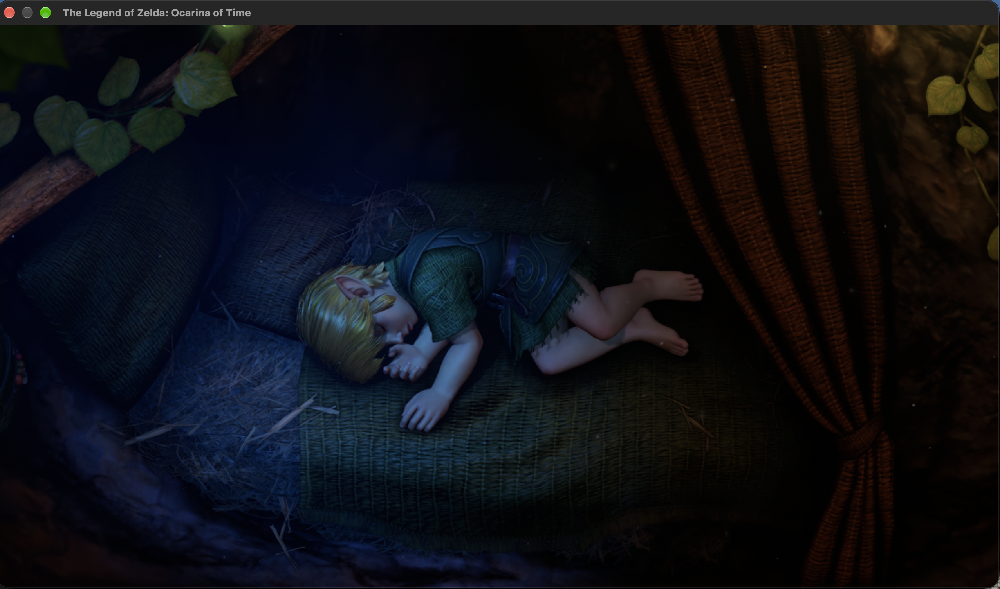

<div align="center">

<!-- Tab Navigation Header -->
<div align="center">
  <a href="README.md"><b>📖 Overview & Guide</b></a> &nbsp;&nbsp;|&nbsp;&nbsp;
  <a href="SUPPORTED_GAMES.md"><b>🎮 Supported Games & Timeline</b></a> &nbsp;&nbsp;|&nbsp;&nbsp;
  <a href="CONTRIBUTING.md"><b>🤝 Contributing</b></a> &nbsp;&nbsp;|&nbsp;&nbsp;
  <a href="https://gitlab.com/rennan-group2/nxnative_Launcher/-/releases"><b>📦 Releases & Downloads (.dmg)</b></a>
</div>

<br>

<p align="center">
  
</p>

# NxNative Launcher

### The Definitive Native Game Porting & Playback Suite for Apple Silicon

<p align="center">
  Switch 2 games have started too: <a href="dm/games/0400486024DEC000/README.md"><b>The Legend of Zelda: Ocarina of Time</b></a>, <a href="dm/games/040074A01BF12000/README.md"><b>Donkey Kong Bananza</b></a>, <a href="dm/games/0400380020056000/README.md"><b>Splatoon Raiders</b></a>, <a href="dm/games/04007EF01F8AE000/README.md"><b>Fire Emblem Fortune's Weave</b></a>, <a href="dm/games/0400A3A01EE4C000/README.md"><b>Pokémon Pokopia</b></a>, <a href="dm/games/04003F40232DE000/README.md"><b>Hyrule Warriors: Age of Imprisonment</b></a>, <a href="dm/games/0400C3F00006E000/README.md"><b>Mario Kart World</b></a>, <a href="dm/games/0400D4201C6EA000/README.md"><b>Mario Tennis Fever</b></a>, <a href="dm/games/0400245021D2C000/README.md"><b>Yoshi and the Mysterious Book</b></a> and <a href="dm/games/0400E88025B1A000/README.md"><b>Star Fox</b></a> play natively on the Mac, packed from one <a href="#switch-2-games"><code>.nup</code> file</a> or a dump of the game; iPhone and iPad are untested.
</p>

[](https://gitlab.com/rennan-group2/nxnative_Launcher/-/releases)
[](https://gitlab.com/rennan-group2/nxnative_Launcher)
[](https://github.com/seedds/nxnative)
[%20%7C%20iOS%2026%2B%20(Metal%204)-blue.svg)](https://apple.com/macos)
[-orange.svg)](https://apple.com)
[-success.svg)](#supported-games-catalog-144-titles)
[](LICENSE)
[-informational.svg)](#-clean-room--legal-policy)

<p align="center">
  <b>Port, configure, and play your legally owned Nintendo Switch and Switch 2 games natively on Apple Silicon Macs and iOS devices with true 60–120 FPS, Apple Metal 4 & MetalFX, 3D Mouse Look Camera Control, Universal Gamepad & Key Remapping, Up to 8 Controller Profiles, Cross-Save iCloud Sync, Hardware-Aware Porting Estimation, and zero terminal friction.</b>
</p>

Switch 2 games are built from one `.nup` file or a folder of their files, not from NSPs, and are tested on the Mac only: see [Switch 2 games](#switch-2-games) and the [144+ Native macOS Game Gallery](#-supported-games-catalog-144-titles).

<p align="center">
  <a href="#-table-of-contents--índice-rápido"><b>🇺🇸 English Documentation</b></a> • 
  <a href="#-guia-rápido-em-português-pt-br"><b>🇧🇷 Guia em Português (PT-BR)</b></a> •
  <a href="https://gitlab.com/rennan-group2/nxnative_Launcher/-/releases"><b>💾 Download Latest .DMG (v1.9.6)</b></a> •
  <a href="#-supported-games-catalog-144-titles"><b>🎮 Supported Games Gallery (144+ Titles)</b></a>
</p>

</div>

---

> [!NOTE]
> ### 📢 Official Notice regarding GitHub Repository
> The original GitHub repository (`github.com/rennan101/nxnative_Launcher`) is **temporarily suspended**, but our development team is actively addressing it and it will return to normal operation soon. In the meantime, **GitLab** (`gitlab.com/rennan-group2/nxnative_Launcher`) is our primary, active official home where all source code, commits, and releases are actively published.

---

> [!IMPORTANT]
> ### 🏛️ Dedicated to Video Game Preservation — *"For those who come after"*
> **NxNative Launcher** is an open-source technical initiative dedicated to digital video game preservation, computer science research, and hardware interoperability. As physical consoles age and proprietary hardware enters obsolescence, our objective is to ensure that games lawfully acquired by players can endure, run natively, and be preserved on modern Apple Silicon personal computers—safeguarding interactive culture and heritage for future generations (*"for those who come after"*).
>
> 🚫 **Zero Tolerance for Piracy & No Game Distribution Policy**:
> - **We DO NOT distribute, host, seed, mirror, or bundle copies of games, ROMs, NSPs, XCIs, updates, or DLC files.**
> - **We DO NOT distribute proprietary cryptographic keys (`prod.keys`, `title.keys`), key seeds, certificates, or proprietary console firmware.**
> - **We DO NOT host or distribute copyrighted box arts, cover artwork, or proprietary game assets.**
> - **Users are strictly required to dump and supply their own legally purchased games and encryption keys extracted from their personally owned Nintendo hardware.**
> - NxNative Launcher operates strictly under Section 1201(f) of the Digital Millennium Copyright Act (17 U.S.C. § 1201(f) - Reverse Engineering for Interoperability) and international fair use doctrines. We actively condemn and do not condone digital copyright infringement or software piracy in any form.

---

## 📑 Table of Contents / Índice Rápido

| Section | Highlights |
| :--- | :--- |
| [🎬 Live Showcase](#live-showcase) | Console library carousel demo & visual interface tour |
| [💡 Why Native Recompilation?](#why-native-recompilation-the-advantage) | Emulation vs. NxNative comparison, 0% CPU translation penalty |
| [✨ What's New & Build Highlights](#key-innovations-current-build-highlights) | Switch 2 support, 5-shelf library, hardware time estimator, 8 players, zero-hang |
| [⚡ Quick Start Guide](#quick-start-guide) | 60-second player setup, `.dmg` installation & source developer instructions |
| [📦 GitLab Releases & Latest DMG](#gitlab-releases--latest-dmg) | Where to find official binaries, automated release management & permanent links |
| [🛠️ Environment & Prerequisites](#environment-prerequisites) | In-app automated installer & manual terminal commands |
| [🚀 3-Step Porting Tutorial](#3-step-porting-tutorial) | Drag & drop, target platform selection (.app / .ipa), hardware estimate, launching |
| [🕹️ Configuration, Mods & Saves](#configuration-saves-atmosphere-mods) | LayeredFS mods, 60 FPS patches, and 1-click save backups |
| [🎮 Controls & 3D Camera Guide](#controls-3d-camera-guide) | FPS mouse look, 8 gamepad profiles, custom key mapping |
| [📚 Supported Games Catalog](#-supported-games-catalog-144-titles) | 144+ verified native macOS games (10 Switch 2 + 134 Switch 1), visual gallery & [SUPPORTED_GAMES.md](SUPPORTED_GAMES.md) |
| [🗺️ Roadmap & Milestones](#roadmap-community-lineage) | Completed milestones, in active development, clean-room policy |
| [⚖️ Clean-Room & Legal Policy](#clean-room--legal-policy) | Preservation manifesto, DMCA § 1201(f), nominative fair use |
| [🙏 Acknowledgements](#acknowledgements) | Special gratitude to seedds and the open-source engineering lineage |
| [🇧🇷 Guia Rápido em Português](#guia-rápido-em-português-pt-br) | Instalação simplificada, tutorial passo a passo, manifesto e controles |

---

## 🎬 Live Showcase

> Experience a console-grade desktop application with fluid navigation between screens, dynamic cover carousels, responsive Apple Liquid Glass neon accents, and instantaneous 60 FPS performance toggles in full Retina clarity:

<p align="center">
  
</p>

---

## 💡 Why Native Recompilation? The Advantage

Traditional Nintendo Switch emulators (such as Yuzu or Ryujinx) rely on **Just-In-Time (JIT) dynamic translation** and dynamic shader translation. On Apple Silicon, this introduces substantial CPU overhead, micro-stutters during shader compilation, and heavy thermal battery drain.

**NxNative Launcher** utilizes ahead-of-time (AOT) native static recompilation powered by [`seedds/nxnative`](https://github.com/seedds/nxnative). Game binaries are converted directly into native macOS/iOS Mach-O executables, with shaders rebuilt ahead-of-time directly for Apple Metal:

| Benchmark / Metric | Traditional Emulation | 🚀 NxNative Native Recompilation | Player & Developer Benefit |
| :--- | :---: | :---: | :--- |
| **CPU Overhead** | High (40% – 85% CPU load) | **Near Zero (10% – 25% CPU load)** | Cooler operation, zero CPU bottleneck, max battery life |
| **Shader Compilation** | Runtime JIT (Shader stutter) | **Ahead-of-Time Metal Prebuild** | Silky smooth 60 FPS with zero mid-game stuttering |
| **Graphics API** | Vulkan / MoltenVK wrapper | **Direct Native Metal 4 & MetalFX** | Full hardware upscaling, HDR, and Retina sharpness |
| **Controls & Camera** | Clunky simulated stick | **True 3D Mouse Look (FPS Mode)** | Play third/first-person games with native PC mouse precision |
| **Library Organization**| Static text lists | **5-Shelf Liquid Glass Carousel** | Dedicated shelves for Mac, Switch 2, iOS, PC & Unported dumps |
| **Multiplayer / Controllers**| Limited slot mapping | **Up to 8 Players / Controller Profiles** | Instant couch co-op with DualSense, Switch Pro, and Xbox controllers |
| **Cross-Platform Saves**| Manual directory navigation | **Smart iCloud Sync & 1-Click Finder** | Seamless continuity between Mac and iPhone 15/16 Pro |
| **Porting Complexity** | Terminal scripts & flags | **Visual Wizard + Time Estimator** | Zero terminal friction; hardware-aware ETA calculation |

---

## ✨ Key Innovations & Current Build Highlights

### 1. ⚡ Nintendo Switch 2 (Ounce) Architecture Support
- **Direct Switch 2 Game Execution**: Play Switch 2 titles natively on Apple Silicon Macs, recompiled from dumped game folders (`0400...` Title IDs like Pokémon Pokopia, Donkey Kong Bananza, and Splatoon Raiders).
- **Clean-Room Ampere Shader Translation**: Translates Ampere GPU instructions directly into native Apple Metal without requiring proprietary `prod.keys`.
- **Integrated Updates & DLCs**: Automatically detects and groups `base/exefs/`, `base/romfs/`, `updates/<version>/`, and `dlc/<id>/` hierarchies.

<p align="center">
  
</p>

---

### 2. 🗂️ 5-Shelf Intelligent Library Categorization in My Games
- **Mac (macOS Native)**: Standalone compiled `.app` Mach-O bundles running directly on Apple Silicon Metal.
- **Switch 2 (Ounce)**: Next-generation Switch 2 games translated to Metal.
- **iPhone / iPad (iOS Port)**: Sideloadable `.ipa` packages ready for direct deployment via `xcrun devicectl` or AirDrop.
- **Non-Switch Games**: Standalone Mac and PC ports cataloged directly in the unified library.
- **Nintendo Switch Files**: Unported game dumps (`.nsp`, `.xci`, `.nsz`, folders) with an instant 1-click **Port Game** modal.

<p align="center">
  
</p>

---

### 3. 👥 Up to 8 Players & Individual Controller Profiles
- **8 Simultaneous Gamepads**: Connect and play local multiplayer titles with up to 8 players simultaneously.
- **Universal Gamepad Detection**: Automatic recognition for Nintendo Switch Pro Controller, PlayStation DualSense / DualShock 4, and Xbox Wireless Controllers.
- **Independent Profile Mapping**: Configure button maps, analog deadzones, and vibration settings individually per controller slot.

<p align="center">
  
</p>

---

### 4. ⏱️ Hardware-Aware Porting Time Estimator (`BuildEstimationService`)
- **Real-Time Mac Chip Detection**: Live inspection of Apple Silicon architecture (`M1`, `M2`, `M3`, `M4`) and active CPU core count.
- **Predictive Compilation ETA**: Calculates accurate time ranges based on RomFS asset gigabytes, shader table count, and previous build cache state.
- **Visual Speed Badges**:
  - ⚡ **Instant Rebuild**: Shaders cached; app packaging takes ~15–30 seconds.
  - 🟢 **Fast**: Lightweight title, completed within 1–3 minutes.
  - 🟡 **Moderate**: Mid-range title with standard shader complexity.
  - 🟠 **Heavy**: Complex AAA open-world titles (e.g. Tears of the Kingdom).
  - 🟣 **Extensive**: Heavy shader workloads requiring multi-threaded compilation.

---

### 5. 🛡️ Invariant Zero-Hang Launch Guarantee & Watchdog System
- **6-Second Active Watchdog**: The launcher protects against unresponsive game processes. If a game fails to start within 6 seconds, the watchdog resets the UI state, prevents infinite loading spinners (`launchingGameId = nil`), and emits an audio alert.
- **Bounded 2.0s Subprocess Timeouts**: All pre-flight operations (`xattr -dr`, `codesign`, `xcrun`) execute with strict bounded timeouts, preventing terminal or I/O locks.
- **Full Environment Inheritance**: Launches inherit `ProcessInfo.processInfo.environment`, ensuring critical system variables (`PATH`, `HOME`, `USER`) are never stripped, preventing `SIGSEGV` crashes.

---

### 6. 💎 Apple Liquid Glass Design System
- **Cinematic Glassmorphism**: Built from custom SwiftUI rendering components with translucent refraction, specular rims, and depth layering.
- **Liquid Glass Sliders & Pickers**: Continuous volume, deadzone, and sensitivity adjustments use `NXLiquidGlassSlider`; mode switching uses `NXLiquidSegmentedPicker` with physical pill animations.
- **8 Neon Accent Themes**: Choose between Neon Cyan, Electric Purple, Sunset Amber, Emerald Green, Hot Pink, Laser Red, Oceanic Blue, or Midnight Stealth.

<p align="center">
  
</p>

---

### 7. 🎮 True 3D Mouse Look (FPS Camera Control) & Couch Gamepad
- **True 3D Mouse Look**: Control game cameras directly with smooth mouse movements in first-person and third-person titles.
- **Granular Sensitivity & Invert Y**: Individual sliders for X and Y axes, plus an inverted pitch toggle. Instant hotkey toggle (`F1` by default).
- **Full Gamepad Navigation**: Navigate every tab, card, modal, and settings slider using your controller (D-Pad, Analog Stick, A to select, B to return). Hold the controller Guide / Home button for 3 seconds to exit back to the launcher.

<p align="center">
  
</p>

---

### 8. ☁️ Smart iCloud Cross-Save & Single-Button Device Sync
- **Automatic Save Resolution**: Automatically indexes `~/Library/Application Support/nxnative/<TID>/save` with a one-click **"Saves"** button to reveal files in Finder.
- **Bidirectional Device Sync**: Instantly transfer save files and Atmosphere mods between your Mac and paired iPhones or iPads.
- **Automatic Local Fallback**: If iCloud permissions are revoked or denied, the launcher and game host automatically fall back to local Application Support storage to prevent progress loss.

<p align="center">
  
</p>

---

### 9. 🌍 14 International Locales & NxNative Launcher Status Bar Icon
- **NxNative Launcher Status Bar Icon**: Quick status and launcher menu access directly from your macOS menu bar.
- **14 International Locales**: Sorted alphabetically in Settings for effortless selection:
  - 🇺🇸 English • 🇧🇷 Português (Brasil) • 🇵🇹 Português (Portugal) • 🇪🇸 Español • 🇫🇷 Français • 🇩🇪 Deutsch • 🇮🇹 Italiano • 🇯🇵 日本語 • 🇰🇷 한국어 • 🇵🇱 Polski • 🇷🇺 Русский • 🇸🇪 Svenska • 🇨🇳 简体中文 • 🇭🇰 繁體中文.

---

## ⚡ Quick Start Guide

### 🎮 For Gamers (Play in 60 Seconds)
1. **Download the Official Release**: Grab the latest `NxNative_Launcher.dmg` from the [GitLab Releases](https://gitlab.com/rennan-group2/nxnative_Launcher/-/releases) page.
2. **Mount and Install**: Open `NxNative_Launcher.dmg` and drag `NxNative_Launcher.app` into your `Applications` folder.
3. **Launch & Auto-Install**: On first launch, if toolchains are missing, click **"Install Missing Dependencies"** in Settings. The app handles Homebrew, Python, and required packages automatically.
4. **Port Your First Game**: Go to the **Port** tab, drag and drop your game dump folder, review the hardware time estimate, click **"Start Porting"**, and play!

### 🛠️ For Developers (Build from Source)
```bash
# 1. Clone repository with submodules
git clone --recurse-submodules https://gitlab.com/rennan-group2/nxnative_Launcher.git
cd nxnative_Launcher

# 2. Build the Swift GUI application
./scripts/build_gui.sh

# 3. (Optional) Generate the standalone DMG installer
./scripts/create_dmg.sh

# 4. Launch the compiled application
open ../NxNative_Launcher.app
```

---

## 📦 GitLab Releases & Latest DMG

We maintain automated release packaging for GitLab. Every production update generates a compressed `.dmg` and publishes it to the repository's Releases page.

- **Permanent Latest Release Link (v1.9.6)**:
  Always points to the newest release without needing to guess tag numbers:
  👉 **[https://gitlab.com/rennan-group2/nxnative_Launcher/-/releases](https://gitlab.com/rennan-group2/nxnative_Launcher/-/releases)**
- **All Releases Archive**:
  👉 **[https://gitlab.com/rennan-group2/nxnative_Launcher/-/releases](https://gitlab.com/rennan-group2/nxnative_Launcher/-/releases)**

To package and deploy a new release from the command line:
```bash
./scripts/gitlab_release.sh
```

---

## 🛠️ Environment & Prerequisites

### System Requirements (Metal 4 Required)
* **Operating System**:
  - **macOS 26.6 or later (macOS Tahoe)** — **Strictly Required**. `nxnative`'s graphics host and shader pipeline rely directly on **Apple Metal 4** (`MTL4CommandQueue`, `MTL4Compiler`, `MTL4RenderCommandEncoder`, `MTL4MeshRenderPipelineDescriptor`). Older macOS versions (macOS 13 Ventura, 14 Sonoma, 15 Sequoia) do **not** include Metal 4 and cannot compile or run games.
  - **iOS 26.0+ / iPadOS 26.0+** — Required for sideloaded `.ipa` builds on iPhone and iPad (Metal 4 runtime).
* **Xcode & Metal Toolchain**: **Xcode 27.2** (or newer with `MetalToolchain` installed via `xcodebuild -downloadComponent MetalToolchain`).
* **Architecture**: Apple Silicon Mac (`M1`, `M2`, `M3`, `M4` or higher) or iOS/iPadOS 26+ device (`A17 Pro`, `A18`, `A18 Pro`, `A19` or M-series iPad).
* **Storage**: 15–20 GB of free space recommended for compilation toolchains, caches, and RomFS assets.

### Manual Dependency Installation (Optional)
If you prefer setting up dependencies manually via Terminal instead of the in-app installer:
```bash
# 1. Install Xcode Command Line Tools & Metal Toolchain
xcode-select --install
xcodebuild -downloadComponent MetalToolchain

# 2. Install Homebrew packages
brew install python@3.13 cmake ninja pkg-config xcodegen zstd glslang
brew install --cask dotnet-sdk

# 3. Install Python dependencies for asset extraction & shader translation
python3 -m pip install --break-system-packages \
  pycryptodome zstandard lz4 libhac fonttools nsz zbic "capstone>=5,<6" "backports.zstd; python_version < '3.14'"
```

---

## 🚀 3-Step Porting Tutorial

<p align="center">
  
</p>

### Step 1: Drag & Drop Game Dumps
Drop any folder containing your dumped `.nsp`, `.nsz`, `.xci`, or Switch 2 directory (`base/exefs/main.npdm`). The wizard automatically matches Base games with their corresponding Updates and DLC packs.

### Step 2: Configure Target & Review Hardware Estimate
Choose your target output:
- **macOS Native Application (`.app`)**: Ready for instant double-click playback on your Mac.
- **iOS Sideloadable Package (`.ipa`)**: Ready for iPhone 15 Pro, iPhone 16 Pro, or iPad Pro.
- Check the **Hardware Estimate Card**: Visualizes expected build duration based on your Mac chip, core count, and shader cache status.

### Step 3: Library Launch & Device Sideloading
Monitor real-time progress from ExeFS extraction to Metal shader building. Once finished, launch directly from the **Library** or deploy to iOS via AirDrop / `xcrun devicectl`.

---

## 🕹️ Configuration, Saves & Atmosphere Mods

### Game Details Deck
Clicking any game in the Library opens the **Game Details Deck**:
* **60 FPS & MetalFX**: Toggle high frame rates and Metal upscaling dynamically.
* **Atmosphere LayeredFS Mods**: Add mods to `<Game.app>/Contents/Resources/atmosphere/contents/<TitleID>/`.
* **Save Management**: Reveal saves in Finder with a single click, or sync bi-directionally with iOS devices.

---

### ⚡ Nintendo Switch 2 Support

A Switch 2 game is built from one [NUP](https://github.com/a55uka/nup) container (a `.nup` file) or a folder of its files, not from NSPs. Neither needs `prod.keys`. A game this project has no profile for is surveyed and gets a provisional profile, as NSPs do ([Port another game](docs/development.md#port-another-game)), which may not boot. You get a Mac app; iPhone and iPad are untested.

**From a `.nup` file**, which holds the base game, its updates and DLC in one file. Give the file, or a folder that holds it:

```
python3 scripts/build_ipa_from_nsp.py ~/Games/DonkeyKongBananza.nup --platform mac-app
```

[Hyrule Warriors: Age of Imprisonment](dm/games/04003F40232DE000/README.md) is played this way: its 47 GB NUP unpacks in under five minutes. A NUP that carries the game's control data (its NACP) and icon gives the app the game's name and icon; otherwise the name comes from the game's profile and the app has no icon.

A NUP without the base game also works, when its base package is empty or it has none and its updates are marked `standalone_update`: the update is taken as the whole game, and the script says so. If the game then stops on missing files, that update holds only what changed: pack a NUP with the base game. The newest update is selected by default; `--package v<N>` selects another version in the container. Such a container has no `v0` (base game) to select.

**From a folder of files**. The script expects this layout (`updates` and `dlc` are optional):

A Switch 2 game is built from a folder containing its files:
```
~/Games/DonkeyKongBananza/
  base/exefs/                     main, main.npdm, sdk, rtld
  base/romfs/
  updates/458752/exefs/           the update's version, as a decimal number
  updates/458752/romfs/           the patched RomFS, not a patch
  dlc/040074a01bf13001/0/romfs/   the DLC's title ID
```

---

An update's folder alone will do (no `base/`), and so will `exefs/` and `romfs/` directly in the folder, as `nup extract` writes them, which count as `base/`. The app has no icon, because the folder holds none. To turn such a folder into a NUP: `nup pack ~/Games/DonkeyKongBananza game.nup`.

### Mouse & Keyboard (FPS Mode)
| Action | Default Shortcut |
| :--- | :--- |
| **Toggle 3D Mouse Look** | `F1` (Configurable) |
| **Camera Movement** | Mouse movement (X/Y Sensitivity adjustable) |
| **Movement (Left Stick)** | `W` / `A` / `S` / `D` |
| **Face Buttons (A / B / X / Y)** | `L` / `K` / `I` / `O` (or remapped to Mouse 4 / 5) |
| **Triggers (ZL / ZR)** | `Q` / `E` |
| **Bumpers (L / R)** | `U` / `P` |
| **Plus (+) / Minus (-)** | `Return` / `Tab` |

### Gamepad Mapping Reference (Up to 8 Players)
| Switch Action | Xbox Controller | PlayStation DualSense | Nintendo Layout |
| :--- | :---: | :---: | :---: |
| **A / B / X / Y** | B / A / Y / X | Circle / Cross / Triangle / Square | A / B / X / Y |
| **Left Stick / D-Pad** | Left Stick / D-Pad | Left Stick / D-Pad | Left Stick / D-Pad |
| **Camera (Right Stick)** | Right Stick | Right Stick | Right Stick |
| **ZL / ZR** | Left Trigger / Right Trigger | L2 / R2 | ZL / ZR |
| **Exit to Launcher** | Hold Xbox Guide (3s) | Hold PS Button (3s) | Hold Home Button (3s) |

---

## 📚 Supported Games Catalog (144+ Titles)

**NxNative Launcher** ports and runs **144+ verified Nintendo Switch and Switch 2 games natively on Apple Silicon macOS** (plus iOS `.ipa` support for Switch 1 titles) by statically recompiling 64-bit ARM game binaries and translating NVN / NVN2 (Ampere) GPU shaders directly to **Apple Metal**.

Under a game, `"60 fps with 1.2.0"` means it runs at 60 fps (30 on the console) with that update. `"Up to 120 fps"` names no update because the host finds the frame rate in the game's code, whichever version it is; choose it under Frame rate, on a screen that shows 120 Hz. **Switch 2 (`0400...`) games appear first at the top of the gallery below:**

<!-- gallery: written by dm/tools/docs_gallery.py from docs/images/gallery.tsv; change the table, then run it -->
<table>
<tr>
<td align="center" valign="top" width="33%"><br><small><b><a href="dm/games/0400486024DEC000/README.md">The Legend of Zelda: Ocarina of Time</a></b><br>Switch 2, Mac only, from a NUP</small></td>
<td align="center" valign="top" width="33%"><br><small><b><a href="dm/games/040074A01BF12000/README.md">Donkey Kong Bananza</a></b><br>Switch 2, Mac only, from a dump</small></td>
<td align="center" valign="top" width="33%"><br><small><b><a href="dm/games/0400380020056000/README.md">Splatoon Raiders</a></b><br>Switch 2, Mac only, from a dump</small></td>
</tr>
<tr>
<td align="center" valign="top" width="33%"><br><small><b><a href="dm/games/04007EF01F8AE000/README.md">Fire Emblem Fortune's Weave</a></b><br>Switch 2, Mac only, from a dump, up to 120 fps</small></td>
<td align="center" valign="top" width="33%"><br><small><b><a href="dm/games/0400A3A01EE4C000/README.md">Pokémon Pokopia</a></b><br>Switch 2, Mac only, from a dump</small></td>
<td align="center" valign="top" width="33%"><br><small><b><a href="dm/games/04003F40232DE000/README.md">Hyrule Warriors: Age of Imprisonment</a></b><br>Switch 2, Mac only, from a NUP</small></td>
</tr>
<tr>
<td align="center" valign="top" width="33%"><br><small><b><a href="dm/games/0400C3F00006E000/README.md">Mario Kart World</a></b><br>Switch 2, Mac only, from a dump</small></td>
<td align="center" valign="top" width="33%"><br><small><b><a href="dm/games/0400D4201C6EA000/README.md">Mario Tennis Fever</a></b><br>Switch 2, Mac only, from a dump</small></td>
<td align="center" valign="top" width="33%"><br><small><b><a href="dm/games/0400245021D2C000/README.md">Yoshi and the Mysterious Book</a></b><br>Switch 2, Mac only</small></td>
</tr>
<tr>
<td align="center" valign="top" width="33%"><br><small><b><a href="dm/games/0400E88025B1A000/README.md">Star Fox</a></b><br>Switch 2, Mac only, from a NUP</small></td>
<td align="center" valign="top" width="33%"><br><small><b><a href="dm/games/0100152000022000/README.md">Mario Kart 8 Deluxe</a></b><br>no Mii heads</small></td>
<td align="center" valign="top" width="33%"><br><small><b><a href="dm/games/0100B99019412000/README.md">Mario vs. Donkey Kong</a></b></small></td>
</tr>
<tr>
<td align="center" valign="top" width="33%"><br><small><b><a href="dm/games/0100ECD018EBE000/README.md">Paper Mario: The Thousand-Year Door</a></b><br>60 fps with 1.0.1</small></td>
<td align="center" valign="top" width="33%"><br><small><b><a href="dm/games/010028600EBDA000/README.md">Super Mario 3D World + Bowser's Fury</a></b></small></td>
<td align="center" valign="top" width="33%"><br><small><b><a href="dm/games/010015100B514000/README.md">Super Mario Bros. Wonder</a></b></small></td>
</tr>
<tr>
<td align="center" valign="top" width="33%"><br><small><b><a href="dm/games/010049900F546000/README.md">Super Mario 3D All-Stars</a></b><br>Super Mario 64 and Sunshine; Galaxy is 32-bit ARM, which Apple silicon cannot run</small></td>
<td align="center" valign="top" width="33%"><br><small><b><a href="dm/games/010099C022B96000/README.md">Super Mario Galaxy</a></b></small></td>
<td align="center" valign="top" width="33%"><br><small><b><a href="dm/games/0100FD8022DAA000/README.md">Super Mario Galaxy 2</a></b></small></td>
</tr>
<tr>
<td align="center" valign="top" width="33%"><br><small><b><a href="dm/games/0100000000010000/README.md">Super Mario Odyssey</a></b></small></td>
<td align="center" valign="top" width="33%"><br><small><b><a href="dm/games/01007EF00011E000/README.md">The Legend of Zelda: Breath of the Wild</a></b><br>60 fps with 1.9.0</small></td>
<td align="center" valign="top" width="33%"><br><small><b><a href="dm/games/01006BB00C6F0000/README.md">The Legend of Zelda: Link's Awakening</a></b></small></td>
</tr>
<tr>
<td align="center" valign="top" width="33%"><br><small><b><a href="dm/games/0100F2C0115B6000/README.md">The Legend of Zelda: Tears of the Kingdom</a></b><br>60 fps with 1.4.3</small></td>
<td align="center" valign="top" width="33%"><br><small><b><a href="dm/games/01003FC01670C000/README.md">13 Sentinels: Aegis Rim</a></b></small></td>
<td align="center" valign="top" width="33%"><br><small><b><a href="dm/games/0100A83022A22000/README.md">Absolum</a></b></small></td>
</tr>
<tr>
<td align="center" valign="top" width="33%"><br><small><b><a href="dm/games/010005501E68C000/README.md">Ace Attorney Investigations Collection</a></b></small></td>
<td align="center" valign="top" width="33%"><br><small><b><a href="dm/games/0100300012F2A000/README.md">Advance Wars 1+2: Re-Boot Camp</a></b></small></td>
<td align="center" valign="top" width="33%"><br><small><b><a href="dm/games/010089B00D09C000/README.md">AI: THE SOMNIUM FILES</a></b></small></td>
</tr>
<tr>
<td align="center" valign="top" width="33%"><br><small><b><a href="dm/games/0100713016CCC000/README.md">AI: THE SOMNIUM FILES - nirvanA Initiative</a></b></small></td>
<td align="center" valign="top" width="33%"><br><small><b><a href="dm/games/01006F8002326000/README.md">Animal Crossing: New Horizons</a></b></small></td>
<td align="center" valign="top" width="33%"><br><small><b><a href="dm/games/010020D01AD24000/README.md">ANIMAL WELL</a></b></small></td>
</tr>
<tr>
<td align="center" valign="top" width="33%"><br><small><b><a href="dm/games/01007300020FA000/README.md">ASTRAL CHAIN</a></b><br>60 fps target with 1.0.1</small></td>
<td align="center" valign="top" width="33%"><br><small><b><a href="dm/games/0100CD801CE5E000/README.md">Balatro</a></b><br>played by touch</small></td>
<td align="center" valign="top" width="33%"><br><small><b><a href="dm/games/010086A022444000/README.md">BALL x PIT</a></b></small></td>
</tr>
<tr>
<td align="center" valign="top" width="33%"><br><small><b><a href="dm/games/010076F0049A2000/README.md">Bayonetta</a></b></small></td>
<td align="center" valign="top" width="33%"><br><small><b><a href="dm/games/01007960049A0000/README.md">Bayonetta 2</a></b></small></td>
<td align="center" valign="top" width="33%"><br><small><b><a href="dm/games/01004A4010FEA000/README.md">Bayonetta 3</a></b></small></td>
</tr>
<tr>
<td align="center" valign="top" width="33%"><br><small><b><a href="dm/games/0100620012D6E000/README.md">Big Brain Academy: Brain vs. Brain</a></b></small></td>
<td align="center" valign="top" width="33%"><br><small><b><a href="dm/games/0100F5D01DA3A000/README.md">Brain Memory Training Academy</a></b></small></td>
<td align="center" valign="top" width="33%"><br><small><b><a href="dm/games/01009BF0072D4000/README.md">Captain Toad: Treasure Tracker</a></b></small></td>
</tr>
<tr>
<td align="center" valign="top" width="33%"><br><small><b><a href="dm/games/0100BF00112C0000/README.md">Catherine: Full Body</a></b></small></td>
<td align="center" valign="top" width="33%"><br><small><b><a href="dm/games/01002B30028F6000/README.md">Celeste</a></b></small></td>
<td align="center" valign="top" width="33%"><br><small><b><a href="dm/games/0100A5C00D162000/README.md">Cuphead</a></b></small></td>
</tr>
<tr>
<td align="center" valign="top" width="33%"><br><small><b><a href="dm/games/01004AB00A260000/README.md">DARK SOULS: REMASTERED</a></b><br>60 fps with 1.0.3</small></td>
<td align="center" valign="top" width="33%"><br><small><b><a href="dm/games/010014E00DB56000/README.md">Digimon Story Cyber Sleuth: Complete Edition</a></b></small></td>
<td align="center" valign="top" width="33%"><br><small><b><a href="dm/games/0100C1F0051B6000/README.md">Donkey Kong Country: Tropical Freeze</a></b></small></td>
</tr>
<tr>
<td align="center" valign="top" width="33%"><br><small><b><a href="dm/games/0100A9D01C446000/README.md">DRAGON QUEST VII Reimagined</a></b><br>60 fps with 1.2.0</small></td>
<td align="center" valign="top" width="33%"><br><small><b><a href="dm/games/01006C300E9F0000/README.md">DRAGON QUEST XI S: Echoes of an Elusive Age – Definitive Edition</a></b><br>60 fps with 1.0.4</small></td>
<td align="center" valign="top" width="33%"><br><small><b><a href="dm/games/0100606026F12000/README.md">FINAL FANTASY RESONANCE</a></b><br>60 fps with 1.0.1</small></td>
</tr>
<tr>
<td align="center" valign="top" width="33%"><br><small><b><a href="dm/games/010038B015560000/README.md">FINAL FANTASY TACTICS - The Ivalice Chronicles</a></b></small></td>
<td align="center" valign="top" width="33%"><br><small><b><a href="dm/games/0100A6301214E000/README.md">Fire Emblem Engage</a></b><br>60 fps with 2.0.0</small></td>
<td align="center" valign="top" width="33%"><br><small><b><a href="dm/games/010055D009F78000/README.md">Fire Emblem: Three Houses</a></b><br>60 fps with 1.2.0</small></td>
</tr>
<tr>
<td align="center" valign="top" width="33%"><br><small><b><a href="dm/games/010029B018432000/README.md">Ghost Trick: Phantom Detective</a></b></small></td>
<td align="center" valign="top" width="33%"><br><small><b><a href="dm/games/010036E00FB20000/README.md">The Great Ace Attorney Chronicles</a></b></small></td>
<td align="center" valign="top" width="33%"><br><small><b><a href="dm/games/0100535012974000/README.md">Hades</a></b></small></td>
</tr>
<tr>
<td align="center" valign="top" width="33%"><br><small><b><a href="dm/games/0100A00019DE0000/README.md">Hades II</a></b></small></td>
<td align="center" valign="top" width="33%"><br><small><b><a href="dm/games/010013C00E930000/README.md">Hollow Knight: Silksong</a></b></small></td>
<td align="center" valign="top" width="33%"><br><small><b><a href="dm/games/01002B00111A2000/README.md">Hyrule Warriors: Age of Calamity</a></b><br>60 fps with 1.3.0</small></td>
</tr>
<tr>
<td align="center" valign="top" width="33%"><br><small><b><a href="dm/games/01004D300C5AE000/README.md">Kirby and the Forgotten Land</a></b></small></td>
<td align="center" valign="top" width="33%"><br><small><b><a href="dm/games/0100DCA0064A6000/README.md">Luigi's Mansion 3</a></b><br>60 fps with 1.4.0</small></td>
<td align="center" valign="top" width="33%"><br><small><b><a href="dm/games/010093801237C000/README.md">Metroid Dread</a></b></small></td>
</tr>
<tr>
<td align="center" valign="top" width="33%"><br><small><b><a href="dm/games/0100B04011742000/README.md">Monster Hunter Rise</a></b><br>60 fps with 16.0.2</small></td>
<td align="center" valign="top" width="33%"><br><small><b><a href="dm/games/010051701FB46000/README.md">Monster Train 2</a></b><br>60 fps with 1.1.1</small></td>
<td align="center" valign="top" width="33%"><br><small><b><a href="dm/games/010057D006492000/README.md">OCTOPATH TRAVELER</a></b></small></td>
</tr>
<tr>
<td align="center" valign="top" width="33%"><br><small><b><a href="dm/games/01005270232F2000/README.md">Octopath Traveler 0</a></b><br>60 fps with 1.0.5</small></td>
<td align="center" valign="top" width="33%"><br><small><b><a href="dm/games/0100A3501946E000/README.md">Octopath Traveler II</a></b><br>60 fps with 1.1.1</small></td>
<td align="center" valign="top" width="33%"><br><small><b><a href="dm/games/0100E44016C22000/README.md">Patrick's Parabox</a></b></small></td>
</tr>
<tr>
<td align="center" valign="top" width="33%"><br><small><b><a href="dm/games/01005CA01580E000/README.md">Persona 5 Royal</a></b></small></td>
<td align="center" valign="top" width="33%"><br><small><b><a href="dm/games/0100B7C00933A000/README.md">Pikmin 4</a></b></small></td>
<td align="center" valign="top" width="33%"><br><small><b><a href="dm/games/0100000011D90000/README.md">Pokémon Brilliant Diamond</a></b><br>60 fps with 1.3.0</small></td>
</tr>
<tr>
<td align="center" valign="top" width="33%"><br><small><b><a href="dm/games/0100F43008C44000/README.md">Pokémon Legends: Z-A</a></b></small></td>
<td align="center" valign="top" width="33%"><br><small><b><a href="dm/games/0100A3D008C5C000/README.md">Pokémon Scarlet</a></b></small></td>
<td align="center" valign="top" width="33%"><br><small><b><a href="dm/games/01008F6008C5E000/README.md">Pokémon Violet</a></b></small></td>
</tr>
<tr>
<td align="center" valign="top" width="33%"><br><small><b><a href="dm/games/0100ABF008968000/README.md">Pokémon Sword</a></b></small></td>
<td align="center" valign="top" width="33%"><br><small><b><a href="dm/games/01008DB008C2C000/README.md">Pokémon Shield</a></b></small></td>
<td align="center" valign="top" width="33%"><br><small><b><a href="dm/games/01007BB017812000/README.md">Portal</a></b></small></td>
</tr>
<tr>
<td align="center" valign="top" width="33%"><br><small><b><a href="dm/games/010020400E1C2000/README.md">Raging Loop</a></b></small></td>
<td align="center" valign="top" width="33%"><br><small><b><a href="dm/games/0100D9F01D474000/README.md">Rhythm Heaven Groove</a></b></small></td>
<td align="center" valign="top" width="33%"><br><small><b><a href="dm/games/0100C2A01A730000/README.md">ROMANCE OF THE THREE KINGDOMS 8 REMAKE</a></b><br>controller only</small></td>
</tr>
<tr>
<td align="center" valign="top" width="33%"><br><small><b><a href="dm/games/01008C0016544000/README.md">Sea of Stars</a></b></small></td>
<td align="center" valign="top" width="33%"><br><small><b><a href="dm/games/010069C01AB82000/README.md">SHIN MEGAMI TENSEI V: Vengeance</a></b><br>60 fps with 1.0.3</small></td>
<td align="center" valign="top" width="33%"><br><small><b><a href="dm/games/0100E65002BB8000/README.md">Stardew Valley</a></b></small></td>
</tr>
<tr>
<td align="center" valign="top" width="33%"><br><small><b><a href="dm/games/01008BC024FDE000/README.md">STEINS;GATE RE:BOOT</a></b></small></td>
<td align="center" valign="top" width="33%"><br><small><b><a href="dm/games/01006A800016E000/README.md">Super Smash Bros. Ultimate</a></b><br>offline</small></td>
<td align="center" valign="top" width="33%"><br><small><b><a href="dm/games/0100346017304000/README.md">Taiko Risshiden V DX</a></b><br>Japanese · played by touch</small></td>
</tr>
<tr>
<td align="center" valign="top" width="33%"><br><small><b><a href="dm/games/010069401ADB8000/README.md">Unicorn Overlord</a></b></small></td>
<td align="center" valign="top" width="33%"><br><small><b><a href="dm/games/01006000040C2000/README.md">Yoshi's Crafted World</a></b></small></td>
<td align="center" valign="top" width="33%"><br><small><b><a href="dm/games/010056B015FE8000/README.md">NieR:Automata The End of YoRHa Edition</a></b><br>60 fps with 1.0.3</small></td>
</tr>
<tr>
<td align="center" valign="top" width="33%"><br><small><b><a href="dm/games/01008CF01BAAC000/README.md">The Legend of Zelda: Echoes of Wisdom</a></b></small></td>
<td align="center" valign="top" width="33%"><br><small><b><a href="dm/games/01009D901BC56000/README.md">Donkey Kong Country Returns HD</a></b></small></td>
<td align="center" valign="top" width="33%"><br><small><b><a href="dm/games/0100317013770000/README.md">Mario + Rabbids Sparks of Hope</a></b></small></td>
</tr>
<tr>
<td align="center" valign="top" width="33%"><br><small><b><a href="dm/games/0100E95004038000/README.md">Xenoblade Chronicles 2</a></b></small></td>
<td align="center" valign="top" width="33%"><br><small><b><a href="dm/games/010074F013262000/README.md">Xenoblade Chronicles 3</a></b></small></td>
<td align="center" valign="top" width="33%"><br><small><b><a href="dm/games/0100CE4010AAC000/README.md">FINAL FANTASY CRYSTAL CHRONICLES Remastered Edition</a></b></small></td>
</tr>
<tr>
<td align="center" valign="top" width="33%"><br><small><b><a href="dm/games/010032E00E6E2000/README.md">Return of the Obra Dinn</a></b></small></td>
<td align="center" valign="top" width="33%"><br><small><b><a href="dm/games/010040801A4C8000/README.md">Blasphemous 2</a></b></small></td>
<td align="center" valign="top" width="33%"><br><small><b><a href="dm/games/0100D5B026844000/README.md">Silver Pines</a></b></small></td>
</tr>
<tr>
<td align="center" valign="top" width="33%"><br><small><b><a href="dm/games/0100698009C6E000/README.md">Blasphemous</a></b></small></td>
<td align="center" valign="top" width="33%"><br><small><b><a href="dm/games/0100BC300CB48000/README.md">FINAL FANTASY X/X-2 HD Remaster</a></b></small></td>
<td align="center" valign="top" width="33%"><br><small><b><a href="dm/games/010067300059A000/README.md">Mario + Rabbids Kingdom Battle</a></b></small></td>
</tr>
<tr>
<td align="center" valign="top" width="33%"><br><small><b><a href="dm/games/010062B01525C000/README.md">Persona 4 Golden</a></b></small></td>
<td align="center" valign="top" width="33%"><br><small><b><a href="dm/games/0100FF500E34A000/README.md">Xenoblade Chronicles: Definitive Edition</a></b></small></td>
<td align="center" valign="top" width="33%"><br><small><b><a href="dm/games/01001F5010DFA000/README.md">Pokémon Legends: Arceus</a></b></small></td>
</tr>
<tr>
<td align="center" valign="top" width="33%"><br><small><b><a href="dm/games/0100965017338000/README.md">Super Mario Party Jamboree</a></b></small></td>
<td align="center" valign="top" width="33%"><br><small><b><a href="dm/games/01002E7016C46000/README.md">Cult of the Lamb</a></b></small></td>
<td align="center" valign="top" width="33%"><br><small><b><a href="dm/games/0100A3900C3E2000/README.md">Paper Mario: The Origami King</a></b></small></td>
</tr>
<tr>
<td align="center" valign="top" width="33%"><br><small><b><a href="dm/games/0100ACD0163D0000/README.md">Batman: Arkham Knight</a></b></small></td>
<td align="center" valign="top" width="33%"><br><small><b><a href="dm/games/010038600B27E000/README.md">Bastion</a></b></small></td>
<td align="center" valign="top" width="33%"><br><small><b><a href="dm/games/01002CD00A51C000/README.md">Baba Is You</a></b></small></td>
</tr>
<tr>
<td align="center" valign="top" width="33%"><br><small><b><a href="dm/games/010089C01E9CA000/README.md">SteamWorld Heist II</a></b></small></td>
<td align="center" valign="top" width="33%"><br><small><b><a href="dm/games/010016100A186000/README.md">SteamWorld Heist: Ultimate Edition</a></b></small></td>
<td align="center" valign="top" width="33%"><br><small><b><a href="dm/games/010014C011146000/README.md">Subnautica: Below Zero</a></b></small></td>
</tr>
<tr>
<td align="center" valign="top" width="33%"><br><small><b><a href="dm/games/0100CA9002322000/README.md">SteamWorld Dig 2</a></b></small></td>
<td align="center" valign="top" width="33%"><br><small><b><a href="dm/games/0100EC9010258000/README.md">Streets of Rage 4</a></b></small></td>
<td align="center" valign="top" width="33%"><br><small><b><a href="dm/games/01006FE013472000/README.md">Mario Party Superstars</a></b></small></td>
</tr>
<tr>
<td align="center" valign="top" width="33%"><br><small><b><a href="dm/games/0100429011144000/README.md">Subnautica</a></b></small></td>
<td align="center" valign="top" width="33%"><br><small><b><a href="dm/games/01009320084A4000/README.md">SteamWorld Dig</a></b></small></td>
<td align="center" valign="top" width="33%"><br><small><b><a href="dm/games/010092B0091D0000/README.md">Team Sonic Racing</a></b></small></td>
</tr>
<tr>
<td align="center" valign="top" width="33%"><br><small><b><a href="dm/games/0100217023F6C000/README.md">Well Dweller</a></b></small></td>
<td align="center" valign="top" width="33%"><br><small><b><a href="dm/games/010029B0118E8000/README.md">Need for Speed: Hot Pursuit Remastered</a></b><br>60 fps with 1.0.3</small></td>
<td align="center" valign="top" width="33%"><br><small><b><a href="dm/games/0100C49025D3E000/README.md">EA SPORTS FC 27</a></b><br>60 fps with 1.8d.310c</small></td>
</tr>
<tr>
<td align="center" valign="top" width="33%"><br><small><b><a href="dm/games/0100ABD01785C000/README.md">Portal 2</a></b></small></td>
<td align="center" valign="top" width="33%"><br><small><b><a href="dm/games/010031F019294000/README.md">Super Monkey Ball Banana Rumble</a></b></small></td>
<td align="center" valign="top" width="33%"><br><small><b><a href="dm/games/0100199023B2E000/README.md">Atelier Ryza: Ever Darkness &amp; the Secret Hideout DX</a></b></small></td>
</tr>
<tr>
<td align="center" valign="top" width="33%"><br><small><b><a href="dm/games/01003E601E324000/README.md">DRAGON QUEST III HD-2D Remake</a></b><br>60 fps with 1.1.2</small></td>
<td align="center" valign="top" width="33%"><br><small><b><a href="dm/games/0100AE00096EA000/README.md">Hyrule Warriors: Definitive Edition</a></b></small></td>
<td align="center" valign="top" width="33%"><br><small><b><a href="dm/games/010012101468C000/README.md">Metroid Prime Remastered</a></b></small></td>
</tr>
<tr>
<td align="center" valign="top" width="33%"><br><small><b><a href="dm/games/0100D7C01F254000/README.md">DRAGON QUEST I &amp; II HD-2D Remake</a></b></small></td>
<td align="center" valign="top" width="33%"><br><small><b><a href="dm/games/0100646009FBE000/README.md">Dead Cells</a></b></small></td>
<td align="center" valign="top" width="33%"><br><small><b><a href="dm/games/0100633007D48000/README.md">Hollow Knight</a></b></small></td>
</tr>
<tr>
<td align="center" valign="top" width="33%"><br><small><b><a href="dm/games/0100CC80140F8000/README.md">TRIANGLE STRATEGY</a></b><br>60 fps with 1.1.1</small></td>
<td align="center" valign="top" width="33%"><br><small><b><a href="dm/games/0100BA4026E94000/README.md">Castlevania: Belmont's Curse</a></b></small></td>
<td align="center" valign="top" width="33%"><br><small><b><a href="dm/games/010063301BD50000/README.md">SUPER ROBOT WARS Y</a></b></small></td>
</tr>
<tr>
<td align="center" valign="top" width="33%"><br><small><b><a href="dm/games/0100BC0018138000/README.md">Super Mario RPG</a></b></small></td>
<td align="center" valign="top" width="33%"><br><small><b><a href="dm/games/01002DA013484000/README.md">The Legend of Zelda: Skyward Sword HD</a></b></small></td>
<td align="center" valign="top" width="33%"><br><small><b><a href="dm/games/01007A3009184000/README.md">Princess Peach: Showtime!</a></b><br>60 fps with 1.0.0</small></td>
</tr>
<tr>
<td align="center" valign="top" width="33%"><br><small><b><a href="dm/games/01007E3006DDA000/README.md">Kirby Star Allies</a></b></small></td>
<td align="center" valign="top" width="33%"><br><small><b><a href="dm/games/010097F018538000/README.md">DAVE THE DIVER</a></b></small></td>
<td align="center" valign="top" width="33%"><br><small><b><a href="dm/games/01006D0017F7A000/README.md">Mario &amp; Luigi: Brothership</a></b><br>up to 120 fps</small></td>
</tr>
<tr>
<td align="center" valign="top" width="33%"><br><small><b><a href="dm/games/010042000A986000/README.md">DRAGON QUEST BUILDERS 2</a></b></small></td>
<td></td>
<td></td>
</tr>
</table>
<!-- end of gallery -->

<p align="center">
  
</p>

### 🌟 Verified Flagship Highlights (Native macOS Port Catalog)

| Game Title | Platform | Title ID | Target Performance | Highlights & Notes |
| :--- | :---: | :---: | :---: | :--- |
| **[The Legend of Zelda: Ocarina of Time](dm/games/0400486024DEC000/README.md)** | **Switch 2** | `0400486024DEC000` | ⚡ 60 FPS | Native Metal, NVN2 Mesh/Task shaders, ZBIC NUP build |
| **[Donkey Kong Bananza](dm/games/040074A01BF12000/README.md)** | **Switch 2** | `040074A01BF12000` | ⚡ 60 FPS | Native Metal, Ampere shaders, Mac dump/NUP build |
| **[Splatoon Raiders](dm/games/0400380020056000/README.md)** | **Switch 2** | `0400380020056000` | ⚡ 60 FPS | Native Metal, Ampere translation, Mac dump build |
| **[Fire Emblem Fortune's Weave](dm/games/04007EF01F8AE000/README.md)** | **Switch 2** | `04007EF01F8AE000` | 🚀 Up to 120 FPS | Native Metal, Ampere shaders, up to 120 Hz on Mac |
| **[Pokémon Pokopia](dm/games/0400A3A01EE4C000/README.md)** | **Switch 2** | `0400A3A01EE4C000` | ⚡ 60 FPS | ILCA Motor Engine on Ounce, full speed |
| **[Hyrule Warriors: Age of Imprisonment](dm/games/04003F40232DE000/README.md)** | **Switch 2** | `04003F40232DE000` | ⚡ 60 FPS | Native Metal on Ounce, built from a `.nup` |
| **[Mario Kart World](dm/games/0400C3F00006E000/README.md)** | **Switch 2** | `0400C3F00006E000` | ⚡ 60 FPS | Native Metal, Ampere shaders, Mac dump build |
| **[Mario Tennis Fever](dm/games/0400D4201C6EA000/README.md)** | **Switch 2** | `0400D4201C6EA000` | ⚡ 60 FPS | Native Metal, Ampere shaders, Mac dump build |
| **[Yoshi and the Mysterious Book](dm/games/0400245021D2C000/README.md)** | **Switch 2** | `0400245021D2C000` | ⚡ 60 FPS | Native Metal on Switch 2 (Ounce), Mac build |
| **[Star Fox](dm/games/0400E88025B1A000/README.md)** | **Switch 2** | `0400E88025B1A000` | ⚡ 60 FPS | Native Metal on Switch 2, built from a `.nup` |
| **[The Legend of Zelda: Tears of the Kingdom](dm/games/0100F2C0115B6000/README.md)** | Switch 1 | `0100F2C0115B6000` | ⚡ 60 FPS | 60 fps with 1.4.3 patch |
| **[The Legend of Zelda: Breath of the Wild](dm/games/01007EF00011E000/README.md)** | Switch 1 | `01007EF00011E000` | ⚡ 60 FPS | 60 fps with 1.9.0 patch |
| **[Super Mario Odyssey](dm/games/0100000000010000/README.md)** | Switch 1 | `0100000000010000` | ⚡ 60 FPS | Native 60 FPS on Metal |
| **[Super Mario Bros. Wonder](dm/games/010015100B514000/README.md)** | Switch 1 | `010015100B514000` | ⚡ 60 FPS | Native 60 FPS on Metal |
| **[Mario Kart 8 Deluxe](dm/games/0100152000022000/README.md)** | Switch 1 | `0100152000022000` | ⚡ 60 FPS | Native Metal 4, full speed |
| **[Mario & Luigi: Brothership](dm/games/01006D0017F7A000/README.md)** | Switch 1 | `01006D0017F7A000` | 🚀 Up to 120 FPS | Native Metal up to 120 Hz |
| **[Metroid Prime Remastered](dm/games/010012101468C000/README.md)** | Switch 1 | `010012101468C000` | ⚡ 60 FPS | Native 60 FPS on Metal |
| **[Metroid Dread](dm/games/010093801237C000/README.md)** | Switch 1 | `010093801237C000` | ⚡ 60 FPS | Native Metal 60 FPS |
| **[Xenoblade Chronicles: Definitive Edition](dm/games/0100FF500E34A000/README.md)** | Switch 1 | `0100FF500E34A000` | ⚡ 60 FPS | 60 fps with 1.1.2 (plus Xenoblade 2, 3 & X) |
| **[Red Dead Redemption](dm/games/01007820196A6000/README.md)** | Switch 1 | `01007820196A6000` | ⚡ 60 FPS | 60 fps with 1.0.5 |
| **[ASTRAL CHAIN](dm/games/01007300020FA000/README.md)** | Switch 1 | `01007300020FA000` | ⚡ 60 FPS | 60 fps target with 1.0.1 |
| **[Portal 2](dm/games/0100ABD01785C000/README.md)** | Switch 1 | `0100ABD01785C000` | ⚡ 60 FPS | Source Engine native 60 FPS |
| **[Need for Speed: Hot Pursuit Remastered](dm/games/010029B0118E8000/README.md)** | Switch 1 | `010029B0118E8000` | ⚡ 60 FPS | Native 60 FPS mode |
| **[EA SPORTS FC 27](dm/games/0100C49025D3E000/README.md)** | Switch 1 | `0100C49025D3E000` | ⚡ 60 FPS | 60 fps with 1.8d.310c & Frostbite simulation sync |
| **[Paper Mario: The Thousand-Year Door](dm/games/0100ECD018EBE000/README.md)** | Switch 1 | `0100ECD018EBE000` | ⚡ 60 FPS | 60 fps with 1.0.1 |
| **[NieR:Automata The End of YoRHa Edition](dm/games/010056B015FE8000/README.md)** | Switch 1 | `010056B015FE8000` | ⚡ 60 FPS | Full Metal speed |
| **[Persona 5 Royal](dm/games/01005CA01580E000/README.md)** | Switch 1 | `01005CA01580E000` | ⚡ 60 FPS | Native Metal |
| **[Animal Crossing: New Horizons](dm/games/01006F8002326000/README.md)** | Switch 1 | `01006F8002326000` | 30 FPS | Native Metal |
| **[Super Smash Bros. Ultimate](dm/games/01006A800016E000/README.md)** | Switch 1 | `01006A800016E000` | ⚡ 60 FPS | Offline play, full speed |

<br>

👉 **[View the Complete 144+ Supported Games List, Memory Tiers & Per-Game Technical Notes in SUPPORTED_GAMES.md ➔](SUPPORTED_GAMES.md)**

---

## 🗺️ Roadmap & Community Lineage

### ✅ Completed Milestones
* [x] **Up to 8 player / controller support and individual profiles**.
* [x] **Nintendo Switch 2 (Ounce) Architecture Support**: Direct recompilation of Switch 2 games (`0400...`), Ampere GPU shaders translated directly to Metal without requiring `prod.keys`.
* [x] **5-Shelf Category Management in My Games**: Mac Native (`.app`), Switch 2, iPhone / iPad (`.ipa`), Non-Switch Games (PC/Mac ports), and Unported Switch Files.
* [x] **Hardware-Aware Porting Estimator (`BuildEstimationService`)**: Live M1–M4 silicon inspection, CPU core count analysis, and dynamic ETA calculation with instant rebuild cache awareness.
* [x] **Invariant Zero-Hang Launch Guarantee**: 6s active watchdog preventing stuck loading screens, 2s bounded timeouts for system calls (`xattr`, `codesign`, `xcrun`), and full system environment preservation.
* [x] **Apple Liquid Glass Design System**: Glassmorphism with dynamic refraction, `NXLiquidGlassSlider`, `NXLiquidSegmentedPicker`, and 8 neon accent colorways.
* [x] **True 3D Mouse Look (FPS Camera Mode)**: Full mouse camera control with individual X/Y sensitivity sliders and invert Y toggle (`F1`).
* [x] **Smart iCloud Cross-Save & Bi-directional Device Sync**: 1-click Finder reveal and auto-sync between Mac and iOS (iPhone 15/16 Pro, iPad Pro).
* [x] **NxNative Launcher Status bar icon**: Quick menu bar status and access.
* [x] **3-Step Guided Porting Wizard** with auto Base + Update + DLC grouping.
* [x] **Atmosphere LayeredFS Mod Manager** and custom box art support.
* [x] **14 Locales Multi-Language**: Full native translation across 14 languages with alphabetical locale selection.
* [x] **Automated Upstream Synchronization & 130+ Verified Games Catalog**.

### ⏳ In Active Development
- Smooth Navigation
- Better User experience with Gamepads.
- More switch 2 games
- Better Mouse Orbit support

---

## ⚖️ Clean-Room & Legal Policy

> [!IMPORTANT]
> - **Video Game Preservation Mission ("for those who come after")**: NxNative Launcher exists to ensure interactive software heritage survives past physical hardware degradation. We believe video games are a vital cultural art form that deserves technical preservation and backwards compatibility on modern computer architectures.
> - **Strict Anti-Piracy & Clean-Room Standard**: This repository and application **DO NOT** contain, host, seed, mirror, or distribute any proprietary Nintendo cryptographic keys (`prod.keys`, `title.keys`), key seeds, certificates, or firmware dumps. Users are strictly responsible for dumping their own keys and data from their personally owned Nintendo hardware.
> - **Zero Copyrighted Commercial Assets**: **NO** game binaries, NSPs, XCIs, ROMs, DLC files, game updates, or copyrighted commercial artwork/box arts are hosted in or distributed with this repository.
> - **Reverse Engineering for Interoperability (17 U.S.C. § 1201(f))**: NxNative Launcher is an independent, open-source graphical orchestration interface developed exclusively for reverse engineering to achieve interoperability on Apple Silicon (macOS and iOS) under Section 1201(f) of the Digital Millennium Copyright Act (DMCA) and international fair use standards.
> - **Trademark Disclaimer & Nominative Fair Use**: All product names, logos, trademarks, and registered trademarks (including *Nintendo Switch*, *Joy-Con*, and referenced game titles) are property of their respective owners. Their mention in this repository is strictly nominative and descriptive to identify hardware compatibility and software targets. NxNative Launcher is not affiliated with, authorized, sponsored, or endorsed by Nintendo Co., Ltd. or any of its subsidiaries.
> - **Core Engine Lineage**: The recompilation engine is based on the open-source clean-room work of [`seedds/nxnative`](https://github.com/seedds/nxnative).

---

## 🙏 Acknowledgements

This project is built on other people's work ([licenses](https://github.com/seedds/nxnative/blob/main/dm/third_party/README.md)):

* **[seedds/nxnative](https://github.com/seedds/nxnative)**: A monumental thank you to **seedds** for creating `nxnative`. The core clean-room native recompilation engine, the ahead-of-time Metal shader pipelines, the Horizon kernel host, and the foundational macOS/iOS architecture that powers this entire project exist thanks to his brilliant technical breakthroughs, visionary engineering, and continuous open-source leadership.
* **[d2r-mobile](https://github.com/jhaizhou-ops/d2r-mobile)** (MIT): Developed this native-execution approach, for *Diablo II: Resurrected*. `nxnative` started as a copy of its generic parts: the NSO rewriter, the host that stands in for Horizon, the NVN-on-Metal layer, and the iOS app shell. Fixes go both ways.
* **Ryujinx** (MIT): Its shader translator (`Ryujinx.Graphics.Shader`, `Ryujinx.Common` and `Spv.Generator 1.3.2`, in `dm/third_party/ryujinx` with a few fixes listed in [its README](https://github.com/seedds/nxnative/blob/main/dm/third_party/ryujinx/README.md)) turns the games' shaders into SPIR-V. Its emulation of the kernel and system services is also a reference when the host's behaviour is in doubt.
* **[Atmosphère](https://github.com/Atmosphere-NX/Atmosphere)**: Its kernel, *mesosphère*, is the reference for Horizon's synchronization semantics (address arbiter, condition variables).
* **[LibHac](https://github.com/Thealexbarney/LibHac)**: Reads NSPs and layers updates over the base game in `dm/tools/nx_extract`.
* **[SPIRV-Cross](https://github.com/KhronosGroup/SPIRV-Cross)**: SPIR-V to Metal Shading Language.
* **[glslang](https://github.com/KhronosGroup/glslang)**: Compiles the GLSL of OpenGL games to SPIR-V for it.
* **[MacNativeGames](https://github.com/ly05010419/MacNativeGames)** (MIT): The GPU widening of 8-bit indices and in-pass clears in `dm/gfx/nvn/nvn_mtl.m`, and the visibility-counter lowering in the shader translator.

---

## 🇧🇷 Guia Rápido em Português (PT-BR)

> [!NOTE]
> ### 📢 Aviso sobre o Repositório do GitHub
> O repositório original no GitHub (`github.com/rennan101/nxnative_Launcher`) está **temporariamente suspenso**, mas nossa equipe está trabalhando para que ele volte a funcionar normalmente em breve. Enquanto isso, o **GitLab** (`gitlab.com/rennan-group2/nxnative_Launcher`) é o nosso canal principal e oficial, onde todas as novidades, códigos e instaladores estão sendo publicados ativamente.

### 🏛️ Manifesto de Preservação: *"Para Aqueles que Virão Depois"*
O **NxNative Launcher** é uma iniciativa técnica de código aberto dedicada à **preservação digital de jogos**, interoperabilidade e pesquisa em engenharia reversa. Conforme consoles físicos envelhecem e entram em descontinuação comercial, nosso objetivo é garantir que os jogos legitimamente adquiridos continuem jogáveis nos computadores modernos com Apple Silicon — garantindo que esse patrimônio cultural continue acessível *"para aqueles que virão depois"*.

> [!CAUTION]
> **Tolerância Zero com a Pirataria**:
> - **NÃO distribuímos nem hospedamos cópias de jogos, ROMs, NSPs, XCIs, DLCs ou atualizações.**
> - **NÃO distribuímos chaves criptográficas (`prod.keys`, `title.keys`) nem firmwares do console.**
> - **NÃO hospedamos capas, box arts ou artes proprietárias comerciais.**
> - O usuário é integralmente responsável por extrair seus próprios dumps de jogos e chaves de seu próprio hardware adquirido legalmente.

### O que é o NxNative Launcher?
O **NxNative Launcher** é uma aplicação desktop nativa desenvolvida em Swift para Apple Silicon (Mac M1/M2/M3/M4 com **macOS 26.6+ Tahoe** e iPhone 15 Pro / 16 Pro / 17 Pro com **iOS 26.0+**). **Ele não é um emulador tradicional**: o código ARM64 do jogo roda diretamente no processador da Apple sem tradução dinâmica (JIT), e os gráficos são reconstruídos diretamente em **Apple Metal 4** (exigindo obrigatoriamente **macOS 26.6+**, **Xcode 27.2+** e **Metal 4** — versões antigas como macOS 13, 14 ou 15 não possuem suporte ao Metal 4). Atualmente, **mais de 144 jogos verificados** funcionam em port nativo para macOS, incluindo **10 jogos do Nintendo Switch 2** e **134+ jogos do Nintendo Switch 1**.

<p align="center">
  
</p>

### 🎮 Jogos de Nintendo Switch 2 e Switch 1 que Já Funcionam no Port Nativo para macOS
Todos os **144+ jogos** listados na [Galeria Visual de Jogos Suportados](#-supported-games-catalog-144-titles) acima e em [`SUPPORTED_GAMES.md`](SUPPORTED_GAMES.md) podem ser portados como aplicativos `.app` nativos de macOS diretamente pelo **NxNative Launcher**:

- **🔥 Nintendo Switch 2 (10 Jogos Nativos no Mac — via `.nup` ou pasta de dump)**:
  - **[The Legend of Zelda: Ocarina of Time](dm/games/0400486024DEC000/README.md)** (`0400486024DEC000`) — *NOVO na v1.9.6! Suporte completo a pacotes `.nup` com descompressão ZBIC (`zbic` embutido), shaders NVN2 Mesh/Task e Ampere para Metal, vídeos AV1 (`dav1d`) e gameplay em Kokiri Forest / Deku Tree!*
  - **[Donkey Kong Bananza](dm/games/040074A01BF12000/README.md)** (`040074A01BF12000`)
  - **[Splatoon Raiders](dm/games/0400380020056000/README.md)** (`0400380020056000`)
  - **[Fire Emblem Fortune's Weave](dm/games/04007EF01F8AE000/README.md)** (`04007EF01F8AE000` — até 120 FPS)
  - **[Pokémon Pokopia](dm/games/0400A3A01EE4C000/README.md)** (`0400A3A01EE4C000`)
  - **[Hyrule Warriors: Age of Imprisonment](dm/games/04003F40232DE000/README.md)** (`04003F40232DE000`)
  - **[Mario Kart World](dm/games/0400C3F00006E000/README.md)** (`0400C3F00006E000`)
  - **[Mario Tennis Fever](dm/games/0400D4201C6EA000/README.md)** (`0400D4201C6EA000`)
  - **[Yoshi and the Mysterious Book](dm/games/0400245021D2C000/README.md)** (`0400245021D2C000`)
  - **[Star Fox](dm/games/0400E88025B1A000/README.md)** (`0400E88025B1A000`)
- **⚡ Nintendo Switch 1 (134+ Jogos Nativos no Mac e iOS — via `.nsp` / `.nsz` / `.xci` / `.nup`)**:
  - **Franquia Zelda**: *Tears of the Kingdom* (60 FPS), *Breath of the Wild* (60 FPS), *Skyward Sword HD*, *Link's Awakening*, *Echoes of Wisdom*, *Hyrule Warriors: Definitive Edition* & *Age of Calamity*.
  - **Franquia Mario & Nintendo**: *Super Mario Odyssey*, *Super Mario Bros. Wonder*, *Mario Kart 8 Deluxe*, *Super Mario 3D World + Bowser's Fury*, *Super Mario Galaxy 1 & 2*, *Paper Mario: The Thousand-Year Door* (60 FPS), *Super Mario RPG*, *Mario & Luigi: Brothership* (até 120 FPS), *Princess Peach: Showtime!* (60 FPS), *Luigi's Mansion 2 HD & 3*, *Pikmin 1, 2, 3 Deluxe & 4*, *Animal Crossing: New Horizons*, *Super Smash Bros. Ultimate*, *Metroid Dread*, *Metroid Prime Remastered* & *Metroid Prime 4: Beyond*.
  - **RPGs & Grandes Sucessos**: *Xenoblade Chronicles DE, 2, 3 & X* (60 FPS), *Fire Emblem: Three Houses & Engage* (60 FPS), *Persona 5 Royal*, *Shin Megami Tensei V: Vengeance* (60 FPS), *NieR:Automata*, *Red Dead Redemption* (60 FPS), *DARK SOULS: REMASTERED* (60 FPS), *DRAGON QUEST XI S, III HD-2D, I & II HD-2D, VII Reimagined & Builders 2*, *OCTOPATH TRAVELER 0, I & II*, *Hollow Knight*, *Hollow Knight: Silksong* (até 120 FPS), *Hades I & II*, *Celeste*, *Cuphead*, *Balatro*, *DAVE THE DIVER*, *Portal 2* e dezenas de outros!

### Principais Novidades da Versão v1.9.6
1. **Suporte Completo a *The Legend of Zelda: Ocarina of Time* (`0400486024DEC000` - Switch 2) e Descompressão ZBIC (`zbic`) Embutida**: Pacotes `.nup` do SDK 22+ com segmentos comprimidos em ZBIC (`zstd`) agora são extraídos e recompilados automaticamente sem erros, incluindo tradução de shaders NVN2 Mesh/Task, instruções Ampere (`F2IP`, `LDSM`), vídeos AV1 paralelos e otimização de memória em transições de cena (`pool_skip_retired`).
2. **Suporte a Jogos de Nintendo Switch 2 (Ounce)**: Tradução direta de shaders Ampere para Metal sem necessidade de `prod.keys`, com suporte a arquivos `.nup` e pastas de dump completas (`base/`, `updates/`, `dlc/`).
3. **Suporte a até 8 Jogadores / Controles Simultâneos**: Perfis individuais para controles PlayStation DualSense, Switch Pro Controller e Xbox Wireless Controller.
4. **Biblioteca Organizada em 5 Prateleiras**: Categorias dedicadas para Mac Native (`.app`), Switch 2, iPhone / iPad (`.ipa`), Non-Switch Games (jogos de PC/Mac) e Arquivos Switch para portar.
5. **Estimativa de Tempo de Portabilidade por Hardware (`BuildEstimationService`)**: Analisa seu chip Apple Silicon (M1 a M4) e núcleos ativos para prever exatamente quanto tempo levará para compilar o jogo, com selo de reconstrução instantânea caso os shaders já estejam em cache.
6. **Garantia Invariante Zero-Hang no Lançamento**: Watchdog de 6 segundos impedindo qualquer travamento em tela de carregamento, com timeouts rígidos de 2.0s em todos os comandos do sistema.
7. **Design System Apple Liquid Glass**: Efeito de vidro translúcido com refração, sliders físicos táteis (`NXLiquidGlassSlider`) e 8 temas de destaque em neon.

<p align="center">
  
</p>
8. **Navegabilidade Total por Gamepad & Modo Câmera 3D**: Jogue no sofá com suporte a gamepad em 100% da interface, ou use o mouse como câmera livre estilo FPS (`F1`).
9. **Saves no iCloud**: Sincronização inteligente entre Mac e iPhone/iPad com botão de 1 clique para revelar a pasta no Finder.
10. **NxNative Launcher Status bar icon**: Acesso rápido e status diretamente na barra de menus do macOS.
11. **14 Idiomas Suportados**: Totalmente traduzido para Português do Brasil e Português de Portugal.
12. **Instalador Oficial `.dmg` no GitLab**: Sempre disponível através do link permanente do [Latest Release no GitLab](https://gitlab.com/rennan-group2/nxnative_Launcher/-/releases).

### Em Desenvolvimento Ativo
- Smooth Navigation
- Better User experience with Gamepads.
- More switch 2 games
- Better Mouse Orbit support

### Como Começar em 3 Passos (Requisito: macOS 26.6+ Tahoe & Xcode 27.2 com Metal 4)
1. **Baixar o Instalador**: Em um Mac Apple Silicon com **macOS 26.6+ (Tahoe)** e **Xcode 27.2+**, baixe o `NxNative_Launcher.dmg` na página de [Latest Release](https://gitlab.com/rennan-group2/nxnative_Launcher/-/releases) e arraste para sua pasta `Aplicativos`.
2. **Configuração Automática**: Abra o launcher. Na aba **Settings**, caso falte alguma ferramenta, clique em **"Instalar Dependências Faltantes"** (o app instala Homebrew, Python e bibliotecas automaticamente).
3. **Portar e Jogar**: Vá para a aba **Port**, arraste seu arquivo `.nup`, `.nsp`, `.xci` ou pasta com seus dumps do jogo, confira a estimativa de tempo e clique em **"Iniciar Portabilidade"**!

Consulte a lista completa de [144+ Jogos Suportados e Histórico de Features em SUPPORTED_GAMES.md](SUPPORTED_GAMES.md).

### 🙏 Agradecimentos & Linhagem Técnica
Este projeto foi construído sobre o esforço e dedicação de projetos e desenvolvedores extraordinários da comunidade de código aberto ([licenças](https://github.com/seedds/nxnative/blob/main/dm/third_party/README.md)):
* **[seedds/nxnative](https://github.com/seedds/nxnative)**: Nosso agradecimento mais profundo e especial ao **seedds** pela criação do `nxnative`. O motor central de recompilação estática, as pipelines de tradução de shaders para Metal, o emulador de serviços Horizon e a base de engenharia para macOS e iOS existem graças à sua visão pioneira e genialidade técnica.
* **[d2r-mobile](https://github.com/jhaizhou-ops/d2r-mobile)** (MIT): Desenvolveu a abordagem original de execução nativa para *Diablo II: Resurrected*. O `nxnative` começou como cópia de suas partes genéricas: reescritor de NSO, host do Horizon, camada NVN sobre Metal e shell para iOS.
* **Ryujinx** (MIT): Seu tradutor de shaders (`Ryujinx.Graphics.Shader`, `Ryujinx.Common` e `Spv.Generator 1.3.2`, em `dm/third_party/ryujinx`) converte os shaders dos jogos para SPIR-V, e sua implementação de serviços é referência essencial de comportamento do sistema.
* **[Atmosphère](https://github.com/Atmosphere-NX/Atmosphere)**: Seu kernel, *mesosphère*, é a referência para a semântica de sincronização do Horizon (address arbiter, condition variables).
* **[LibHac](https://github.com/Thealexbarney/LibHac)**: Leitura de pacotes NSP e mesclagem de atualizações sobre o jogo base.
* **[SPIRV-Cross](https://github.com/KhronosGroup/SPIRV-Cross)**: Conversão de SPIR-V para Metal Shading Language (MSL).
* **[glslang](https://github.com/KhronosGroup/glslang)**: Compila o GLSL de jogos OpenGL para SPIR-V.
* **[MacNativeGames](https://github.com/ly05010419/MacNativeGames)** (MIT): Alargamento de índices de 8 bits na GPU, in-pass clears em `nvn_mtl.m` e lowering de contadores de visibilidade no tradutor de shaders.

---

<div align="center">
  <p><b>NxNative Launcher is an independent open-source project and is not affiliated with, endorsed by, or connected to Nintendo Co., Ltd.</b></p>
  <a href="SUPPORTED_GAMES.md"><b>🎮 Supported Games (144+ Titles)</b></a> &nbsp;&nbsp;•&nbsp;&nbsp;
  <a href="CONTRIBUTING.md"><b>🤝 Contributing</b></a> &nbsp;&nbsp;•&nbsp;&nbsp;
  <a href="https://gitlab.com/rennan-group2/nxnative_Launcher/-/issues"><b>🐞 Report Bug on GitLab</b></a> &nbsp;&nbsp;•&nbsp;&nbsp;
  <a href="https://gitlab.com/rennan-group2/nxnative_Launcher/-/releases"><b>📦 Latest Release (.dmg)</b></a>
</div>
