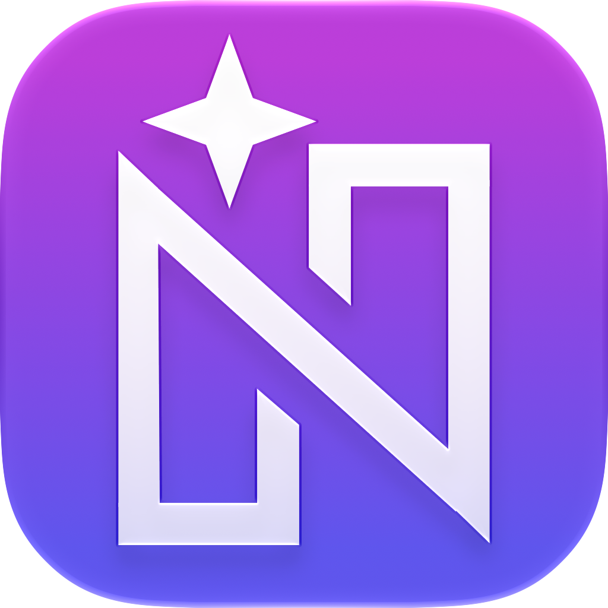
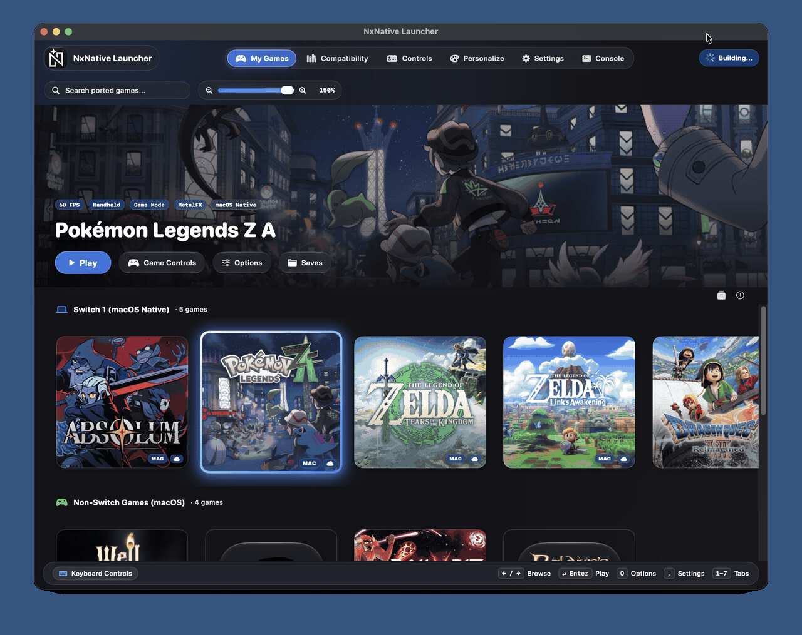
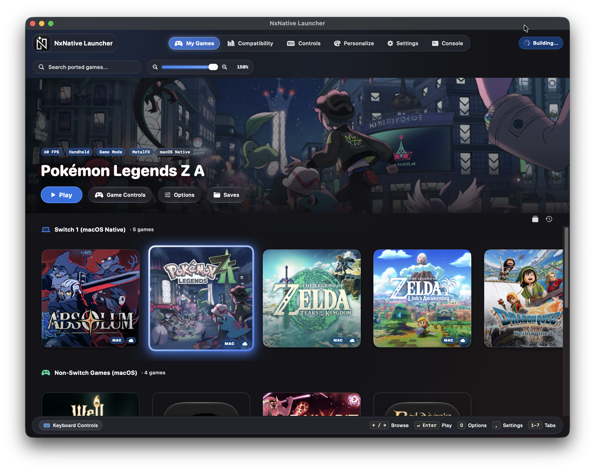
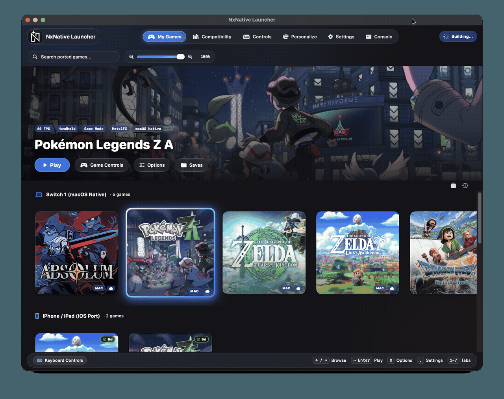
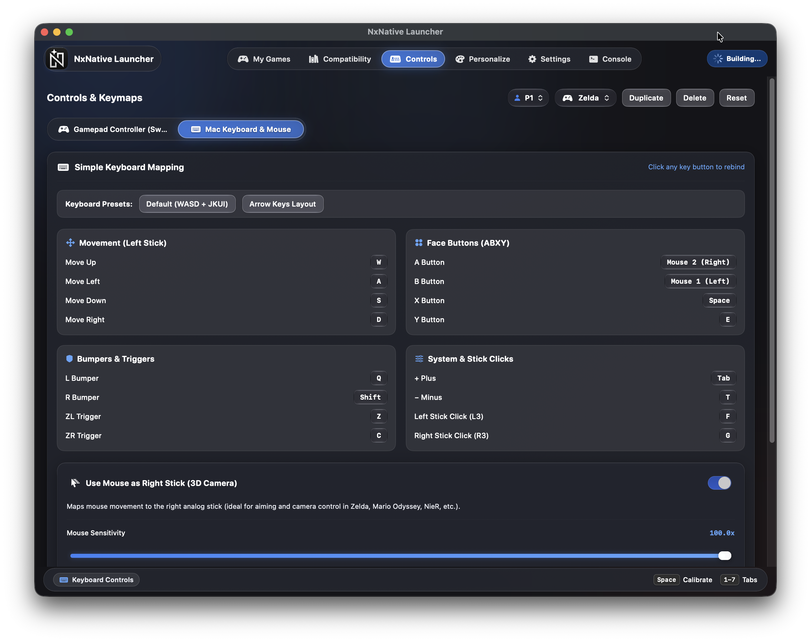
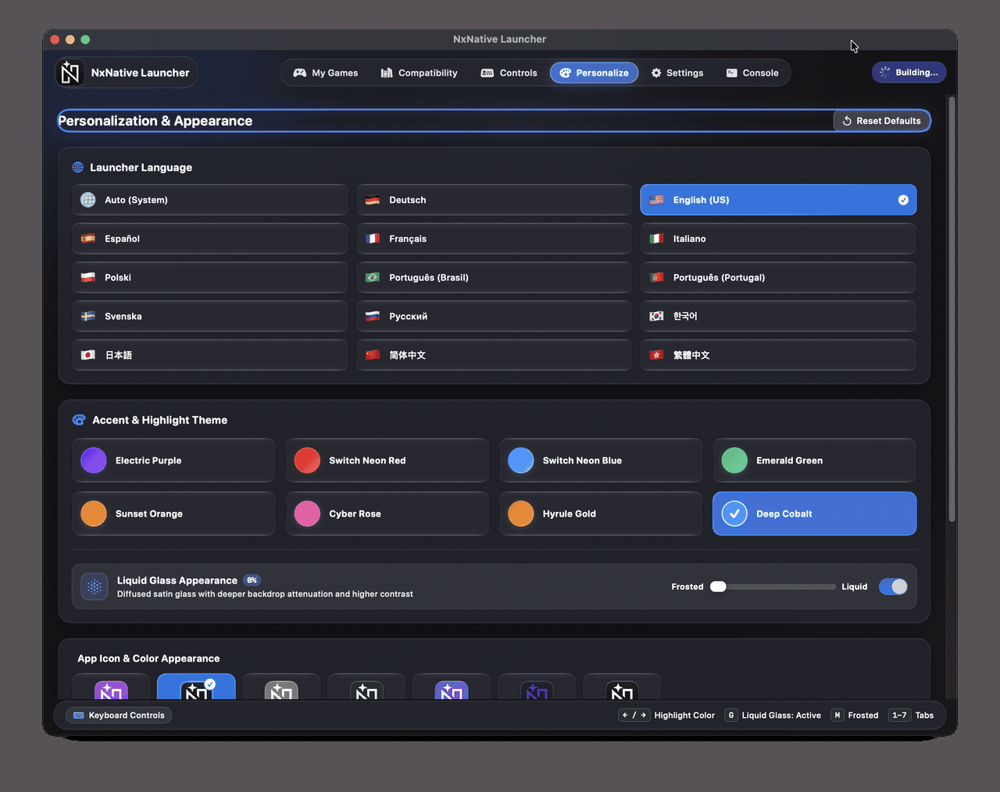
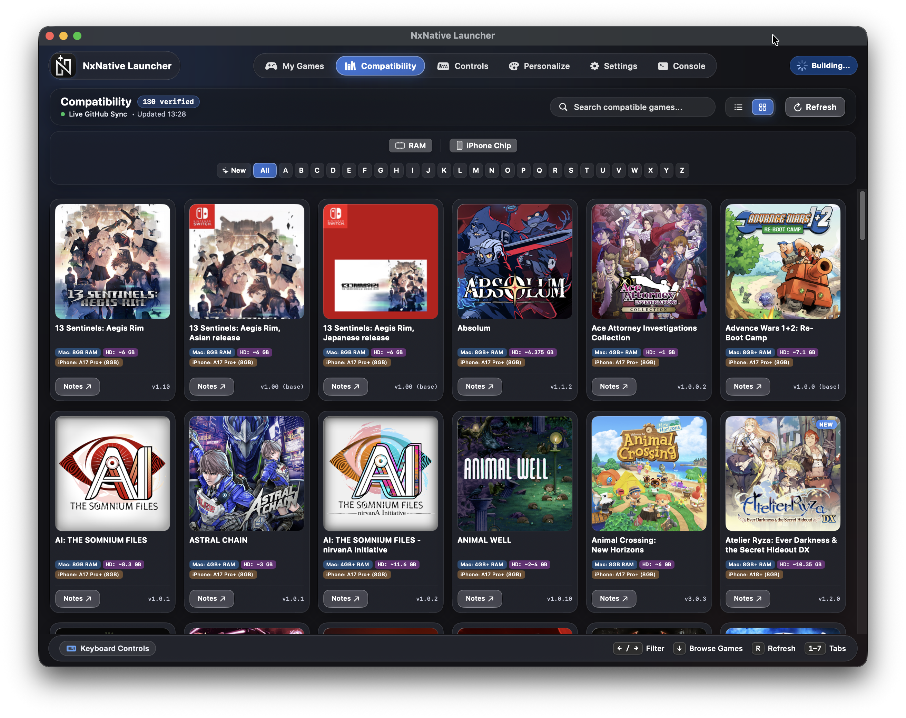

<div align="center">

<!-- Tab Navigation Header -->
<div align="center">
  <a href="README.md"><b>📖 Overview & Guide</b></a> &nbsp;&nbsp;|&nbsp;&nbsp;
  <a href="SUPPORTED_GAMES.md"><b>🎮 Supported Games & Timeline</b></a> &nbsp;&nbsp;|&nbsp;&nbsp;
  <a href="CONTRIBUTING.md"><b>🤝 Contributing</b></a> &nbsp;&nbsp;|&nbsp;&nbsp;
  <a href="https://gitlab.com/rennan-group2/nxnative_Launcher/-/releases"><b>📦 Releases & Downloads (.dmg)</b></a>
</div>

<br>

<a href="https://gitlab.com/rennan-group2/nxnative_Launcher">
  
</a>

# NxNative Launcher

### The Definitive Native Game Porting & Playback Suite for Apple Silicon

[](https://gitlab.com/rennan-group2/nxnative_Launcher/-/releases)
[](https://gitlab.com/rennan-group2/nxnative_Launcher)
[](https://github.com/seedds/nxnative)
[](https://apple.com/macos)
[-orange.svg)](https://apple.com)
[-success.svg)](SUPPORTED_GAMES.md)
[](LICENSE)
[-informational.svg)](#-clean-room--legal-policy)

<p align="center">
  <b>Port, configure, and play your legally owned Nintendo Switch and Switch 2 games natively on Apple Silicon Macs and iOS devices with true 60 FPS, Apple Metal 4 & MetalFX, 3D Mouse Look Camera Control, Universal Gamepad & Key Remapping, Up to 8 Controller Profiles, Cross-Save iCloud Sync, Hardware-Aware Porting Estimation, and zero terminal friction.</b>
</p>

<p align="center">
  <b>⚡ It is not an emulator</b>: The game's ARM64 code runs directly on the Apple Silicon CPU, with graphics rebuilt natively on Metal. No runtime translation overhead, no JIT stutter, and exceptional battery efficiency. Over <b>130+ verified titles</b> run natively, including next-generation <b>Nintendo Switch 2</b> games.
</p>

<p align="center">
  <a href="#-table-of-contents--índice-rápido"><b>🇺🇸 English Documentation</b></a> • 
  <a href="#-guia-rápido-em-português-pt-br"><b>🇧🇷 Guia em Português (PT-BR)</b></a> •
  <a href="https://gitlab.com/rennan-group2/nxnative_Launcher/-/releases"><b>💾 Download Latest .DMG (v1.9.1)</b></a> •
  <a href="SUPPORTED_GAMES.md"><b>🎮 Supported Games List (130+ Titles)</b></a>
</p>

</div>

---

> [!NOTE]
> ### 📢 Official Notice regarding GitHub Repository
> The original GitHub repository (`github.com/rennan101/nxnative_Launcher`) is **temporarily suspended**, but our development team is actively addressing it and it will return to normal operation soon. In the meantime, **GitLab** (`gitlab.com/rennan-group2/nxnative_Launcher`) is our primary, active official home where all source code, commits, and releases are actively published.

---

> [!IMPORTANT]
> ### 🏛️ Dedicated to Video Game Preservation — *"For those who come after"*
> **NxNative Launcher** is an open-source technical initiative dedicated to digital video game preservation, computer science research, and hardware interoperability. As physical consoles age and proprietary hardware enters obsolescence, our objective is to ensure that games lawfully acquired by players can endure, run natively, and be preserved on modern Apple Silicon personal computers—safeguarding interactive culture and heritage for future generations (*"for those who come after"*).
>
> 🚫 **Zero Tolerance for Piracy & No Game Distribution Policy**:
> - **We DO NOT distribute, host, seed, mirror, or bundle copies of games, ROMs, NSPs, XCIs, updates, or DLC files.**
> - **We DO NOT distribute proprietary cryptographic keys (`prod.keys`, `title.keys`), key seeds, certificates, or proprietary console firmware.**
> - **We DO NOT host or distribute copyrighted box arts, cover artwork, or proprietary game assets.**
> - **Users are strictly required to dump and supply their own legally purchased games and encryption keys extracted from their personally owned Nintendo hardware.**
> - NxNative Launcher operates strictly under Section 1201(f) of the Digital Millennium Copyright Act (17 U.S.C. § 1201(f) - Reverse Engineering for Interoperability) and international fair use doctrines. We actively condemn and do not condone digital copyright infringement or software piracy in any form.

---

## 📑 Table of Contents / Índice Rápido

| Section | Highlights |
| :--- | :--- |
| [🎬 Live Showcase](#live-showcase) | Console library carousel demo & visual interface tour |
| [💡 Why Native Recompilation?](#why-native-recompilation-the-advantage) | Emulation vs. NxNative comparison, 0% CPU translation penalty |
| [✨ What's New & Build Highlights](#key-innovations-current-build-highlights) | Switch 2 support, 5-shelf library, hardware time estimator, 8 players, zero-hang |
| [⚡ Quick Start Guide](#quick-start-guide) | 60-second player setup, `.dmg` installation & source developer instructions |
| [📦 GitLab Releases & Latest DMG](#gitlab-releases--latest-dmg) | Where to find official binaries, automated release management & permanent links |
| [🛠️ Environment & Prerequisites](#environment-prerequisites) | In-app automated installer & manual terminal commands |
| [🚀 3-Step Porting Tutorial](#3-step-porting-tutorial) | Drag & drop, target platform selection (.app / .ipa), hardware estimate, launching |
| [🕹️ Configuration, Mods & Saves](#configuration-saves-atmosphere-mods) | LayeredFS mods, 60 FPS patches, and 1-click save backups |
| [🎮 Controls & 3D Camera Guide](#controls-3d-camera-guide) | FPS mouse look, 8 gamepad profiles, custom key mapping |
| [📚 Supported Games Catalog](#supported-games-catalog-130-titles) | 130+ verified games, Switch 2 titles, link to [SUPPORTED_GAMES.md](SUPPORTED_GAMES.md) |
| [🗺️ Roadmap & Milestones](#roadmap-community-lineage) | Completed milestones, in active development, clean-room policy |
| [⚖️ Clean-Room & Legal Policy](#clean-room--legal-policy) | Preservation manifesto, DMCA § 1201(f), nominative fair use |
| [🙏 Acknowledgements](#acknowledgements) | Special gratitude to seedds and the open-source engineering lineage |
| [🇧🇷 Guia Rápido em Português](#guia-rápido-em-português-pt-br) | Instalação simplificada, tutorial passo a passo, manifesto e controles |

---

## 🎬 Live Showcase

> Experience a console-grade desktop application with fluid navigation between screens, dynamic cover carousels, responsive Apple Liquid Glass neon accents, and instantaneous 60 FPS performance toggles in full Retina clarity:

<p align="center">
  
</p>

---

## 💡 Why Native Recompilation? The Advantage

Traditional Nintendo Switch emulators (such as Yuzu or Ryujinx) rely on **Just-In-Time (JIT) dynamic translation** and dynamic shader translation. On Apple Silicon, this introduces substantial CPU overhead, micro-stutters during shader compilation, and heavy thermal battery drain.

**NxNative Launcher** utilizes ahead-of-time (AOT) native static recompilation powered by [`seedds/nxnative`](https://github.com/seedds/nxnative). Game binaries are converted directly into native macOS/iOS Mach-O executables, with shaders rebuilt ahead-of-time directly for Apple Metal:

| Benchmark / Metric | Traditional Emulation | 🚀 NxNative Native Recompilation | Player & Developer Benefit |
| :--- | :---: | :---: | :--- |
| **CPU Overhead** | High (40% – 85% CPU load) | **Near Zero (10% – 25% CPU load)** | Cooler operation, zero CPU bottleneck, max battery life |
| **Shader Compilation** | Runtime JIT (Shader stutter) | **Ahead-of-Time Metal Prebuild** | Silky smooth 60 FPS with zero mid-game stuttering |
| **Graphics API** | Vulkan / MoltenVK wrapper | **Direct Native Metal 4 & MetalFX** | Full hardware upscaling, HDR, and Retina sharpness |
| **Controls & Camera** | Clunky simulated stick | **True 3D Mouse Look (FPS Mode)** | Play third/first-person games with native PC mouse precision |
| **Library Organization**| Static text lists | **5-Shelf Liquid Glass Carousel** | Dedicated shelves for Mac, Switch 2, iOS, PC & Unported dumps |
| **Multiplayer / Controllers**| Limited slot mapping | **Up to 8 Players / Controller Profiles** | Instant couch co-op with DualSense, Switch Pro, and Xbox controllers |
| **Cross-Platform Saves**| Manual directory navigation | **Smart iCloud Sync & 1-Click Finder** | Seamless continuity between Mac and iPhone 15/16 Pro |
| **Porting Complexity** | Terminal scripts & flags | **Visual Wizard + Time Estimator** | Zero terminal friction; hardware-aware ETA calculation |

---

## ✨ Key Innovations & Current Build Highlights

### 1. ⚡ Nintendo Switch 2 (Ounce) Architecture Support
- **Direct Switch 2 Game Execution**: Play Switch 2 titles natively on Apple Silicon Macs, recompiled from dumped game folders (`0400...` Title IDs like Pokémon Pokopia, Donkey Kong Bananza, and Splatoon Raiders).
- **Clean-Room Ampere Shader Translation**: Translates Ampere GPU instructions directly into native Apple Metal without requiring proprietary `prod.keys`.
- **Integrated Updates & DLCs**: Automatically detects and groups `base/exefs/`, `base/romfs/`, `updates/<version>/`, and `dlc/<id>/` hierarchies.

<p align="center">
  
</p>

---

### 2. 🗂️ 5-Shelf Intelligent Library Categorization in My Games
- **Mac (macOS Native)**: Standalone compiled `.app` Mach-O bundles running directly on Apple Silicon Metal.
- **Switch 2 (Ounce)**: Next-generation Switch 2 games translated to Metal.
- **iPhone / iPad (iOS Port)**: Sideloadable `.ipa` packages ready for direct deployment via `xcrun devicectl` or AirDrop.
- **Non-Switch Games**: Standalone Mac and PC ports cataloged directly in the unified library.
- **Nintendo Switch Files**: Unported game dumps (`.nsp`, `.xci`, `.nsz`, folders) with an instant 1-click **Port Game** modal.

<p align="center">
  
</p>

---

### 3. 👥 Up to 8 Players & Individual Controller Profiles
- **8 Simultaneous Gamepads**: Connect and play local multiplayer titles with up to 8 players simultaneously.
- **Universal Gamepad Detection**: Automatic recognition for Nintendo Switch Pro Controller, PlayStation DualSense / DualShock 4, and Xbox Wireless Controllers.
- **Independent Profile Mapping**: Configure button maps, analog deadzones, and vibration settings individually per controller slot.

<p align="center">
  
</p>

---

### 4. ⏱️ Hardware-Aware Porting Time Estimator (`BuildEstimationService`)
- **Real-Time Mac Chip Detection**: Live inspection of Apple Silicon architecture (`M1`, `M2`, `M3`, `M4`) and active CPU core count.
- **Predictive Compilation ETA**: Calculates accurate time ranges based on RomFS asset gigabytes, shader table count, and previous build cache state.
- **Visual Speed Badges**:
  - ⚡ **Instant Rebuild**: Shaders cached; app packaging takes ~15–30 seconds.
  - 🟢 **Fast**: Lightweight title, completed within 1–3 minutes.
  - 🟡 **Moderate**: Mid-range title with standard shader complexity.
  - 🟠 **Heavy**: Complex AAA open-world titles (e.g. Tears of the Kingdom).
  - 🟣 **Extensive**: Heavy shader workloads requiring multi-threaded compilation.

---

### 5. 🛡️ Invariant Zero-Hang Launch Guarantee & Watchdog System
- **6-Second Active Watchdog**: The launcher protects against unresponsive game processes. If a game fails to start within 6 seconds, the watchdog resets the UI state, prevents infinite loading spinners (`launchingGameId = nil`), and emits an audio alert.
- **Bounded 2.0s Subprocess Timeouts**: All pre-flight operations (`xattr -dr`, `codesign`, `xcrun`) execute with strict bounded timeouts, preventing terminal or I/O locks.
- **Full Environment Inheritance**: Launches inherit `ProcessInfo.processInfo.environment`, ensuring critical system variables (`PATH`, `HOME`, `USER`) are never stripped, preventing `SIGSEGV` crashes.

---

### 6. 💎 Apple Liquid Glass Design System
- **Cinematic Glassmorphism**: Built from custom SwiftUI rendering components with translucent refraction, specular rims, and depth layering.
- **Liquid Glass Sliders & Pickers**: Continuous volume, deadzone, and sensitivity adjustments use `NXLiquidGlassSlider`; mode switching uses `NXLiquidSegmentedPicker` with physical pill animations.
- **8 Neon Accent Themes**: Choose between Neon Cyan, Electric Purple, Sunset Amber, Emerald Green, Hot Pink, Laser Red, Oceanic Blue, or Midnight Stealth.

<p align="center">
  
</p>

---

### 7. 🎮 True 3D Mouse Look (FPS Camera Control) & Couch Gamepad
- **True 3D Mouse Look**: Control game cameras directly with smooth mouse movements in first-person and third-person titles.
- **Granular Sensitivity & Invert Y**: Individual sliders for X and Y axes, plus an inverted pitch toggle. Instant hotkey toggle (`F1` by default).
- **Full Gamepad Navigation**: Navigate every tab, card, modal, and settings slider using your controller (D-Pad, Analog Stick, A to select, B to return). Hold the controller Guide / Home button for 3 seconds to exit back to the launcher.

<p align="center">
  
</p>

---

### 8. ☁️ Smart iCloud Cross-Save & Single-Button Device Sync
- **Automatic Save Resolution**: Automatically indexes `~/Library/Application Support/nxnative/<TID>/save` with a one-click **"Saves"** button to reveal files in Finder.
- **Bidirectional Device Sync**: Instantly transfer save files and Atmosphere mods between your Mac and paired iPhones or iPads.
- **Automatic Local Fallback**: If iCloud permissions are revoked or denied, the launcher and game host automatically fall back to local Application Support storage to prevent progress loss.

<p align="center">
  
</p>

---

### 9. 🌍 14 International Locales & NxNative Launcher Status Bar Icon
- **NxNative Launcher Status Bar Icon**: Quick status and launcher menu access directly from your macOS menu bar.
- **14 International Locales**: Sorted alphabetically in Settings for effortless selection:
  - 🇺🇸 English • 🇧🇷 Português (Brasil) • 🇵🇹 Português (Portugal) • 🇪🇸 Español • 🇫🇷 Français • 🇩🇪 Deutsch • 🇮🇹 Italiano • 🇯🇵 日本語 • 🇰🇷 한국어 • 🇵🇱 Polski • 🇷🇺 Русский • 🇸🇪 Svenska • 🇨🇳 简体中文 • 🇭🇰 繁體中文.

---

## ⚡ Quick Start Guide

### 🎮 For Gamers (Play in 60 Seconds)
1. **Download the Official Release**: Grab the latest `NxNative_Launcher.dmg` from the [GitLab Releases](https://gitlab.com/rennan-group2/nxnative_Launcher/-/releases) page.
2. **Mount and Install**: Open `NxNative_Launcher.dmg` and drag `NxNative_Launcher.app` into your `Applications` folder.
3. **Launch & Auto-Install**: On first launch, if toolchains are missing, click **"Install Missing Dependencies"** in Settings. The app handles Homebrew, Python, and required packages automatically.
4. **Port Your First Game**: Go to the **Port** tab, drag and drop your game dump folder, review the hardware time estimate, click **"Start Porting"**, and play!

### 🛠️ For Developers (Build from Source)
```bash
# 1. Clone repository with submodules
git clone --recurse-submodules https://gitlab.com/rennan-group2/nxnative_Launcher.git
cd nxnative_Launcher

# 2. Build the Swift GUI application
./scripts/build_gui.sh

# 3. (Optional) Generate the standalone DMG installer
./scripts/create_dmg.sh

# 4. Launch the compiled application
open ../NxNative_Launcher.app
```

---

## 📦 GitLab Releases & Latest DMG

We maintain automated release packaging for GitLab. Every production update generates a compressed `.dmg` and publishes it to the repository's Releases page.

- **Permanent Latest Release Link (v1.9.1)**:
  Always points to the newest release without needing to guess tag numbers:
  👉 **[https://gitlab.com/rennan-group2/nxnative_Launcher/-/releases](https://gitlab.com/rennan-group2/nxnative_Launcher/-/releases)**
- **All Releases Archive**:
  👉 **[https://gitlab.com/rennan-group2/nxnative_Launcher/-/releases](https://gitlab.com/rennan-group2/nxnative_Launcher/-/releases)**

To package and deploy a new release from the command line:
```bash
./scripts/gitlab_release.sh
```

---

## 🛠️ Environment & Prerequisites

### System Requirements
* **Operating System**: macOS 13.0 (Ventura), macOS 14.0 (Sonoma), or macOS 15.0+ (Sequoia).
* **Architecture**: Apple Silicon Mac (M1, M2, M3, M4 or higher) or iOS 18+ (A17 Pro, A18, A18 Pro, M-series iPad).
* **Storage**: 15–20 GB of free space recommended for compilation toolchains, caches, and RomFS assets.

### Manual Dependency Installation (Optional)
If you prefer setting up dependencies manually via Terminal instead of the in-app installer:
```bash
# 1. Install Xcode Command Line Tools & Metal Toolchain
xcode-select --install
xcodebuild -downloadComponent MetalToolchain

# 2. Install Homebrew packages
brew install python@3.13 cmake ninja pkg-config xcodegen zstd glslang
brew install --cask dotnet-sdk

# 3. Install Python dependencies for asset extraction & shader translation
python3 -m pip install --break-system-packages \
  pycryptodome zstandard lz4 libhac fonttools nsz zbic "capstone>=5,<6" "backports.zstd; python_version < '3.14'"
```

---

## 🚀 3-Step Porting Tutorial

<p align="center">
  
</p>

### Step 1: Drag & Drop Game Dumps
Drop any folder containing your dumped `.nsp`, `.nsz`, `.xci`, or Switch 2 directory (`base/exefs/main.npdm`). The wizard automatically matches Base games with their corresponding Updates and DLC packs.

### Step 2: Configure Target & Review Hardware Estimate
Choose your target output:
- **macOS Native Application (`.app`)**: Ready for instant double-click playback on your Mac.
- **iOS Sideloadable Package (`.ipa`)**: Ready for iPhone 15 Pro, iPhone 16 Pro, or iPad Pro.
- Check the **Hardware Estimate Card**: Visualizes expected build duration based on your Mac chip, core count, and shader cache status.

### Step 3: Library Launch & Device Sideloading
Monitor real-time progress from ExeFS extraction to Metal shader building. Once finished, launch directly from the **Library** or deploy to iOS via AirDrop / `xcrun devicectl`.

---

## 🕹️ Configuration, Saves & Atmosphere Mods

### Game Details Deck
Clicking any game in the Library opens the **Game Details Deck**:
* **60 FPS & MetalFX**: Toggle high frame rates and Metal upscaling dynamically.
* **Atmosphere LayeredFS Mods**: Add mods to `<Game.app>/Contents/Resources/atmosphere/contents/<TitleID>/`.
* **Save Management**: Reveal saves in Finder with a single click, or sync bi-directionally with iOS devices.

---

### ⚡ Nintendo Switch 2 Support

Switch 2 games have arrived: **[Donkey Kong Bananza](dm/games/040074A01BF12000/README.md)**, **[Splatoon Raiders](dm/games/0400380020056000/README.md)**, and **[Pokémon Pokopia](dm/games/0400A3A01EE4C000/README.md)** run natively on Apple Silicon Macs, converted directly from a dump folder of the game with Ampere shaders translated directly to Metal without requiring `prod.keys`.

A Switch 2 game is built from a folder containing its files:
```
~/Games/DonkeyKongBananza/
  base/exefs/                     main, main.npdm, sdk, rtld
  base/romfs/
  updates/458752/exefs/           the update's version, as a decimal number
  updates/458752/romfs/           the patched RomFS, not a patch
  dlc/040074a01bf13001/0/romfs/   the DLC's title ID
```

---

## 🎮 Controls & 3D Camera Guide

### Mouse & Keyboard (FPS Mode)
| Action | Default Shortcut |
| :--- | :--- |
| **Toggle 3D Mouse Look** | `F1` (Configurable) |
| **Camera Movement** | Mouse movement (X/Y Sensitivity adjustable) |
| **Movement (Left Stick)** | `W` / `A` / `S` / `D` |
| **Face Buttons (A / B / X / Y)** | `L` / `K` / `I` / `O` (or remapped to Mouse 4 / 5) |
| **Triggers (ZL / ZR)** | `Q` / `E` |
| **Bumpers (L / R)** | `U` / `P` |
| **Plus (+) / Minus (-)** | `Return` / `Tab` |

### Gamepad Mapping Reference (Up to 8 Players)
| Switch Action | Xbox Controller | PlayStation DualSense | Nintendo Layout |
| :--- | :---: | :---: | :---: |
| **A / B / X / Y** | B / A / Y / X | Circle / Cross / Triangle / Square | A / B / X / Y |
| **Left Stick / D-Pad** | Left Stick / D-Pad | Left Stick / D-Pad | Left Stick / D-Pad |
| **Camera (Right Stick)** | Right Stick | Right Stick | Right Stick |
| **ZL / ZR** | Left Trigger / Right Trigger | L2 / R2 | ZL / ZR |
| **Exit to Launcher** | Hold Xbox Guide (3s) | Hold PS Button (3s) | Hold Home Button (3s) |

---

## 📚 Supported Games Catalog (130+ Titles)

NxNative Launcher tracks **over 130 verified playable game profiles**, including titles for both Nintendo Switch and next-generation Nintendo Switch 2.

<p align="center">
  
</p>

### 🌟 Verified Flagship Highlights

| Game Title | Platform | Title ID | Target Performance | Highlights & Notes |
| :--- | :---: | :---: | :---: | :--- |
| **Donkey Kong Bananza** | **Switch 2** | `040074A01BF12000` | ⚡ 60 FPS | Native Metal, Ampere shaders, Mac dump build |
| **Splatoon Raiders** | **Switch 2** | `0400380020056000` | ⚡ 60 FPS | Native Metal, Ampere translation, Mac dump build |
| **Pokémon Pokopia** | **Switch 2** | `0400A3A01EE4C000` | ⚡ 60 FPS | ILCA Motor Engine on Ounce, full speed |
| **The Legend of Zelda: Tears of the Kingdom** | Switch 1 | `0100F2C0115B6000` | ⚡ 60 FPS | 60 fps with 1.4.3 patch |
| **The Legend of Zelda: Breath of the Wild** | Switch 1 | `01007EF00011E000` | ⚡ 60 FPS | 60 fps with 1.9.0 patch |
| **Super Mario Odyssey** | Switch 1 | `0100000000010000` | ⚡ 60 FPS | Native 60 FPS on Metal |
| **Mario Kart 8 Deluxe** | Switch 1 | `0100152000022000` | ⚡ 60 FPS | Native Metal 4, full speed |
| **ASTRAL CHAIN** | Switch 1 | `01007300020FA000` | ⚡ 60 FPS | 60 fps target with 1.0.1 |
| **Portal 2** | Switch 1 | `0100ABD01785C000` | ⚡ 60 FPS | Source Engine native 60 FPS |
| **Need for Speed: Hot Pursuit Remastered** | Switch 1 | `010029B0118E8000` | ⚡ 60 FPS | Native 60 FPS mode |
| **EA SPORTS FC 27** | Switch 1 | `0100C49025D3E000` | ⚡ 60 FPS | 60 fps with 1.8d.310c & Frostbite simulation sync |
| **Paper Mario: The Thousand-Year Door** | Switch 1 | `0100ECD018EBE000` | ⚡ 60 FPS | 60 fps with 1.0.1 |
| **NieR:Automata The End of YoRHa Edition** | Switch 1 | `010056B015FE8000` | ⚡ 60 FPS | Full Metal speed |
| **Metroid Dread** | Switch 1 | `010093801237C000` | ⚡ 60 FPS | Native Metal 60 FPS |
| **Persona 5 Royal** | Switch 1 | `01005CA01580E000` | ⚡ 60 FPS | Native Metal |
| **Animal Crossing: New Horizons** | Switch 1 | `01006F8002326000` | 30 FPS | Native Metal |
| **Super Smash Bros. Ultimate** | Switch 1 | `01006A800016E000` | ⚡ 60 FPS | Offline play, full speed |

<br>

👉 **[View the Complete 130+ Supported Games List, Memory Tiers & Changelog in SUPPORTED_GAMES.md ➔](SUPPORTED_GAMES.md)**

---

## 🗺️ Roadmap & Community Lineage

### ✅ Completed Milestones
* [x] **Up to 8 player / controller support and individual profiles**.
* [x] **Nintendo Switch 2 (Ounce) Architecture Support**: Direct recompilation of Switch 2 games (`0400...`), Ampere GPU shaders translated directly to Metal without requiring `prod.keys`.
* [x] **5-Shelf Category Management in My Games**: Mac Native (`.app`), Switch 2, iPhone / iPad (`.ipa`), Non-Switch Games (PC/Mac ports), and Unported Switch Files.
* [x] **Hardware-Aware Porting Estimator (`BuildEstimationService`)**: Live M1–M4 silicon inspection, CPU core count analysis, and dynamic ETA calculation with instant rebuild cache awareness.
* [x] **Invariant Zero-Hang Launch Guarantee**: 6s active watchdog preventing stuck loading screens, 2s bounded timeouts for system calls (`xattr`, `codesign`, `xcrun`), and full system environment preservation.
* [x] **Apple Liquid Glass Design System**: Glassmorphism with dynamic refraction, `NXLiquidGlassSlider`, `NXLiquidSegmentedPicker`, and 8 neon accent colorways.
* [x] **True 3D Mouse Look (FPS Camera Mode)**: Full mouse camera control with individual X/Y sensitivity sliders and invert Y toggle (`F1`).
* [x] **Smart iCloud Cross-Save & Bi-directional Device Sync**: 1-click Finder reveal and auto-sync between Mac and iOS (iPhone 15/16 Pro, iPad Pro).
* [x] **NxNative Launcher Status bar icon**: Quick menu bar status and access.
* [x] **3-Step Guided Porting Wizard** with auto Base + Update + DLC grouping.
* [x] **Atmosphere LayeredFS Mod Manager** and custom box art support.
* [x] **14 Locales Multi-Language**: Full native translation across 14 languages with alphabetical locale selection.
* [x] **Automated Upstream Synchronization & 130+ Verified Games Catalog**.

### ⏳ In Active Development
- Smooth Navigation
- Better User experience with Gamepads.
- More switch 2 games
- Better Mouse Orbit support

---

## ⚖️ Clean-Room & Legal Policy

> [!IMPORTANT]
> - **Video Game Preservation Mission ("for those who come after")**: NxNative Launcher exists to ensure interactive software heritage survives past physical hardware degradation. We believe video games are a vital cultural art form that deserves technical preservation and backwards compatibility on modern computer architectures.
> - **Strict Anti-Piracy & Clean-Room Standard**: This repository and application **DO NOT** contain, host, seed, mirror, or distribute any proprietary Nintendo cryptographic keys (`prod.keys`, `title.keys`), key seeds, certificates, or firmware dumps. Users are strictly responsible for dumping their own keys and data from their personally owned Nintendo hardware.
> - **Zero Copyrighted Commercial Assets**: **NO** game binaries, NSPs, XCIs, ROMs, DLC files, game updates, or copyrighted commercial artwork/box arts are hosted in or distributed with this repository.
> - **Reverse Engineering for Interoperability (17 U.S.C. § 1201(f))**: NxNative Launcher is an independent, open-source graphical orchestration interface developed exclusively for reverse engineering to achieve interoperability on Apple Silicon (macOS and iOS) under Section 1201(f) of the Digital Millennium Copyright Act (DMCA) and international fair use standards.
> - **Trademark Disclaimer & Nominative Fair Use**: All product names, logos, trademarks, and registered trademarks (including *Nintendo Switch*, *Joy-Con*, and referenced game titles) are property of their respective owners. Their mention in this repository is strictly nominative and descriptive to identify hardware compatibility and software targets. NxNative Launcher is not affiliated with, authorized, sponsored, or endorsed by Nintendo Co., Ltd. or any of its subsidiaries.
> - **Core Engine Lineage**: The recompilation engine is based on the open-source clean-room work of [`seedds/nxnative`](https://github.com/seedds/nxnative).

---

## 🙏 Acknowledgements

This project is built on other people's work ([licenses](https://github.com/seedds/nxnative/blob/main/dm/third_party/README.md)):

* **[seedds/nxnative](https://github.com/seedds/nxnative)**: A monumental thank you to **seedds** for creating `nxnative`. The core clean-room native recompilation engine, the ahead-of-time Metal shader pipelines, the Horizon kernel host, and the foundational macOS/iOS architecture that powers this entire project exist thanks to his brilliant technical breakthroughs, visionary engineering, and continuous open-source leadership.
* **[d2r-mobile](https://github.com/jhaizhou-ops/d2r-mobile)** (MIT): Developed this native-execution approach, for *Diablo II: Resurrected*. `nxnative` started as a copy of its generic parts: the NSO rewriter, the host that stands in for Horizon, the NVN-on-Metal layer, and the iOS app shell. Fixes go both ways.
* **Ryujinx** (MIT): Its shader translator (`Ryujinx.Graphics.Shader`, `Ryujinx.Common` and `Spv.Generator 1.3.2`, in `dm/third_party/ryujinx` with a few fixes listed in [its README](https://github.com/seedds/nxnative/blob/main/dm/third_party/ryujinx/README.md)) turns the games' shaders into SPIR-V. Its emulation of the kernel and system services is also a reference when the host's behaviour is in doubt.
* **[Atmosphère](https://github.com/Atmosphere-NX/Atmosphere)**: Its kernel, *mesosphère*, is the reference for Horizon's synchronization semantics (address arbiter, condition variables).
* **[LibHac](https://github.com/Thealexbarney/LibHac)**: Reads NSPs and layers updates over the base game in `dm/tools/nx_extract`.
* **[SPIRV-Cross](https://github.com/KhronosGroup/SPIRV-Cross)**: SPIR-V to Metal Shading Language.
* **[glslang](https://github.com/KhronosGroup/glslang)**: Compiles the GLSL of OpenGL games to SPIR-V for it.
* **[MacNativeGames](https://github.com/ly05010419/MacNativeGames)** (MIT): The GPU widening of 8-bit indices and in-pass clears in `dm/gfx/nvn/nvn_mtl.m`, and the visibility-counter lowering in the shader translator.

---

## 🇧🇷 Guia Rápido em Português (PT-BR)

> [!NOTE]
> ### 📢 Aviso sobre o Repositório do GitHub
> O repositório original no GitHub (`github.com/rennan101/nxnative_Launcher`) está **temporariamente suspenso**, mas nossa equipe está trabalhando para que ele volte a funcionar normalmente em breve. Enquanto isso, o **GitLab** (`gitlab.com/rennan-group2/nxnative_Launcher`) é o nosso canal principal e oficial, onde todas as novidades, códigos e instaladores estão sendo publicados ativamente.

### 🏛️ Manifesto de Preservação: *"Para Aqueles que Virão Depois"*
O **NxNative Launcher** é uma iniciativa técnica de código aberto dedicada à **preservação digital de jogos**, interoperabilidade e pesquisa em engenharia reversa. Conforme consoles físicos envelhecem e entram em descontinuação comercial, nosso objetivo é garantir que os jogos legitimamente adquiridos continuem jogáveis nos computadores modernos com Apple Silicon — garantindo que esse patrimônio cultural continue acessível *"para aqueles que virão depois"*.

> [!CAUTION]
> **Tolerância Zero com a Pirataria**:
> - **NÃO distribuímos nem hospedamos cópias de jogos, ROMs, NSPs, XCIs, DLCs ou atualizações.**
> - **NÃO distribuímos chaves criptográficas (`prod.keys`, `title.keys`) nem firmwares do console.**
> - **NÃO hospedamos capas, box arts ou artes proprietárias comerciais.**
> - O usuário é integralmente responsável por extrair seus próprios dumps de jogos e chaves de seu próprio hardware adquirido legalmente.

### O que é o NxNative Launcher?
O **NxNative Launcher** é uma aplicação desktop nativa desenvolvida em Swift para Apple Silicon (Mac M1/M2/M3/M4 e iPhone 15/16 Pro). **Ele não é um emulador tradicional**: o código ARM64 do jogo roda diretamente no processador da Apple sem tradução dinâmica (JIT), e os gráficos são reconstruídos diretamente em **Apple Metal 4**. Atualmente, **mais de 130 jogos verificados** funcionam, incluindo jogos do **Nintendo Switch 2**.

<p align="center">
  
</p>

### Principais Novidades da Versão v1.9.1
1. **Suporte a Jogos de Nintendo Switch 2 (Ounce)**: Tradução direta de shaders Ampere para Metal sem necessidade de `prod.keys`, com suporte a pastas de dump completas (`base/`, `updates/`, `dlc/`).
2. **Suporte a até 8 Jogadores / Controles Simultâneos**: Perfis individuais para controles PlayStation DualSense, Switch Pro Controller e Xbox Wireless Controller.
3. **Biblioteca Organizada em 5 Prateleiras**: Categorias dedicadas para Mac Native (`.app`), Switch 2, iPhone / iPad (`.ipa`), Non-Switch Games (jogos de PC/Mac) e Arquivos Switch para portar.
4. **Estimativa de Tempo de Portabilidade por Hardware (`BuildEstimationService`)**: Analisa seu chip Apple Silicon (M1 a M4) e núcleos ativos para prever exatamente quanto tempo levará para compilar o jogo, com selo de reconstrução instantânea caso os shaders já estejam em cache.
5. **Garantia Invariante Zero-Hang no Lançamento**: Watchdog de 6 segundos impedindo qualquer travamento em tela de carregamento, com timeouts rígidos de 2.0s em todos os comandos do sistema.
6. **Design System Apple Liquid Glass**: Efeito de vidro translúcido com refração, sliders físicos táteis (`NXLiquidGlassSlider`) e 8 temas de destaque em neon.

<p align="center">
  
</p>
7. **Navegabilidade Total por Gamepad & Modo Câmera 3D**: Jogue no sofá com suporte a gamepad em 100% da interface, ou use o mouse como câmera livre estilo FPS (`F1`).
8. **Saves no iCloud**: Sincronização inteligente entre Mac e iPhone/iPad com botão de 1 clique para revelar a pasta no Finder.
9. **NxNative Launcher Status bar icon**: Acesso rápido e status diretamente na barra de menus do macOS.
10. **14 Idiomas Suportados**: Totalmente traduzido para Português do Brasil e Português de Portugal.
11. **Instalador Oficial `.dmg` no GitLab**: Sempre disponível através do link permanente do [Latest Release no GitLab](https://gitlab.com/rennan-group2/nxnative_Launcher/-/releases).

### Em Desenvolvimento Ativo
- Smooth Navigation
- Better User experience with Gamepads.
- More switch 2 games
- Better Mouse Orbit support

### Como Começar em 3 Passos
1. **Baixar o Instalador**: Baixe o `NxNative_Launcher.dmg` na página de [Latest Release](https://gitlab.com/rennan-group2/nxnative_Launcher/-/releases) e arraste para sua pasta `Aplicativos`.
2. **Configuração Automática**: Abra o launcher. Na aba **Settings**, caso falte alguma ferramenta, clique em **"Instalar Dependências Faltantes"** (o app instala Homebrew, Python e bibliotecas automaticamente).
3. **Portar e Jogar**: Vá para a aba **Port**, arraste a pasta com seus dumps do jogo, confira a estimativa de tempo e clique em **"Iniciar Portabilidade"**!

Consulte a lista completa de [130+ Jogos Suportados e Histórico de Features em SUPPORTED_GAMES.md](SUPPORTED_GAMES.md).

### 🙏 Agradecimentos & Linhagem Técnica
Este projeto foi construído sobre o esforço e dedicação de projetos e desenvolvedores extraordinários da comunidade de código aberto ([licenças](https://github.com/seedds/nxnative/blob/main/dm/third_party/README.md)):
* **[seedds/nxnative](https://github.com/seedds/nxnative)**: Nosso agradecimento mais profundo e especial ao **seedds** pela criação do `nxnative`. O motor central de recompilação estática, as pipelines de tradução de shaders para Metal, o emulador de serviços Horizon e a base de engenharia para macOS e iOS existem graças à sua visão pioneira e genialidade técnica.
* **[d2r-mobile](https://github.com/jhaizhou-ops/d2r-mobile)** (MIT): Desenvolveu a abordagem original de execução nativa para *Diablo II: Resurrected*. O `nxnative` começou como cópia de suas partes genéricas: reescritor de NSO, host do Horizon, camada NVN sobre Metal e shell para iOS.
* **Ryujinx** (MIT): Seu tradutor de shaders (`Ryujinx.Graphics.Shader`, `Ryujinx.Common` e `Spv.Generator 1.3.2`, em `dm/third_party/ryujinx`) converte os shaders dos jogos para SPIR-V, e sua implementação de serviços é referência essencial de comportamento do sistema.
* **[Atmosphère](https://github.com/Atmosphere-NX/Atmosphere)**: Seu kernel, *mesosphère*, é a referência para a semântica de sincronização do Horizon (address arbiter, condition variables).
* **[LibHac](https://github.com/Thealexbarney/LibHac)**: Leitura de pacotes NSP e mesclagem de atualizações sobre o jogo base.
* **[SPIRV-Cross](https://github.com/KhronosGroup/SPIRV-Cross)**: Conversão de SPIR-V para Metal Shading Language (MSL).
* **[glslang](https://github.com/KhronosGroup/glslang)**: Compila o GLSL de jogos OpenGL para SPIR-V.
* **[MacNativeGames](https://github.com/ly05010419/MacNativeGames)** (MIT): Alargamento de índices de 8 bits na GPU, in-pass clears em `nvn_mtl.m` e lowering de contadores de visibilidade no tradutor de shaders.

---

<div align="center">
  <p><b>NxNative Launcher is an independent open-source project and is not affiliated with, endorsed by, or connected to Nintendo Co., Ltd.</b></p>
  <a href="SUPPORTED_GAMES.md"><b>🎮 Supported Games (130+ Titles)</b></a> &nbsp;&nbsp;•&nbsp;&nbsp;
  <a href="CONTRIBUTING.md"><b>🤝 Contributing</b></a> &nbsp;&nbsp;•&nbsp;&nbsp;
  <a href="https://gitlab.com/rennan-group2/nxnative_Launcher/-/issues"><b>🐞 Report Bug on GitLab</b></a> &nbsp;&nbsp;•&nbsp;&nbsp;
  <a href="https://gitlab.com/rennan-group2/nxnative_Launcher/-/releases"><b>📦 Latest Release (.dmg)</b></a>
</div>
