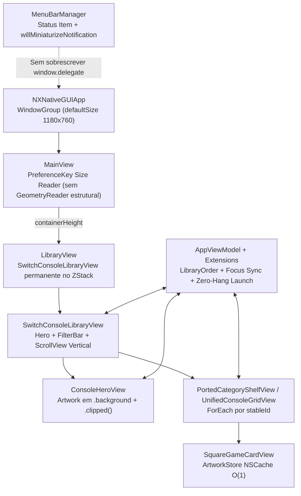

# NativePort / NxNative Launcher — Map of Content (MOC)

Índice central de arquitetura, fluxos críticos e Knowledge Items (KIs) do projeto.

## Documentação e Regras
- [[GEMINI]] — Regras invioláveis: Invariante Zero-Hang no Lançamento, Apple Liquid Glass e Protocolo Anti-Regressão.
- [[frontends]] — Visão geral da interface macOS (`nxnative/gui`).
- [[playing]] / [[settings]] / [[development]] — Execução, variáveis de runtime e pipeline de portabilidade.
- [[agents/README]] — Guias de extração, bringup, gráficos e patches de engine.

## Fluxo de Arquitetura — Aba My Games (`gui/Sources`)

## Knowledge Items (KIs) Estáveis

### KI-01: Preservação do `NSWindowDelegate` do SwiftUI e Layout Inicial
- **Racional**: O SwiftUI gerencia a restauração de frame (`NSWindow Frame ...` no `UserDefaults`) por meio do `AppKitWindowController` registrado como `window.delegate`. Sobrescrever `window.delegate` em `MenuBarManager` durante `didBecomeKeyNotification` interrompe a propagação do novo tamanho para a árvore SwiftUI, travando views internas em `minWidth x minHeight` (`880x574`).
- **Restrição**: Nunca atribuir `window.delegate = self` na janela principal do SwiftUI; interceptar minimização apenas via `standardWindowButton(.miniaturizeButton)` e `NSWindow.willMiniaturizeNotification`. Evitar `GeometryReader` estrutural aninhado em `MainView`, `SwitchConsoleLibraryView` e `ConsoleHeroView`.

### KI-02: Identidade Estável de Cards no Drag-and-Drop (`stableId`)
- **Racional**: Usar `ForEach(items.indices, id: \.self)` em prateleiras ou grades com `.onDrag` mantém a view ancorada ao slot posicional enquanto o `PortedGame` subjacente muda durante a reordenação. Qualquer `@State` local de capa (`cachedIcon`) exibe a arte do card anterior sobre o jogo errado. Além disso, builds `.app` e `.ipa` do mesmo título compartilham `titleId` (`uniqueKey`).
- **Restrição**: Identificar cards sempre por `PortedGame.stableId` (`url.standardizedFileURL.path`) e `UnifiedLibraryItem.stableId`, resolvendo ícones diretamente via `ArtworkStore.shared.loadSquareIcon(for:)` (`NSCache` em memória) sem `@State` de imagem por card. Ao arrastar em modo alfabético (`.name`), `activateManualOrderMode()` comuta para `.lastPlayed` sem disparar reordenação automática sobre o movimento manual.

### KI-03: Transições Liquid Glass na Hero Bar
- **Racional**: Morphing de geometria padrão do Liquid Glass entre modos distintos da Hero Bar (`Port Now` vs `Send to Device` / `Play`) gera sobreposição visual transitória de cápsulas.
- **Restrição**: Manter `.id(actionBarModeKey)` e `.nxGlassTransition(.identity)` nos botões de ação de `ConsoleHeroView+Actions`.
